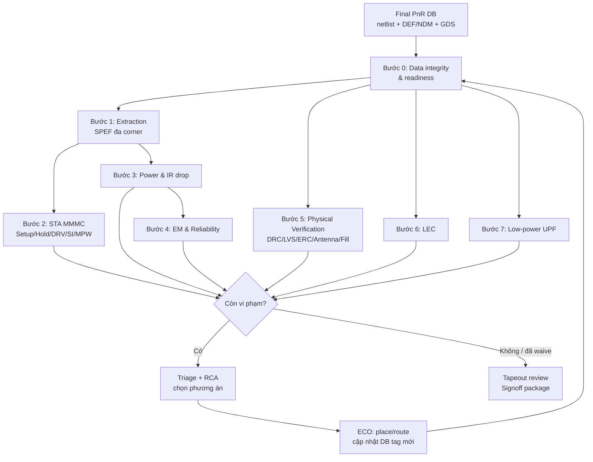
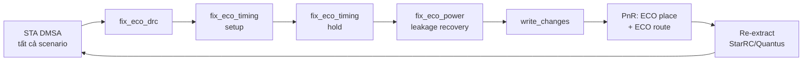

# Phân Tích Chuyên Sâu Các Bước Signoff trong Physical Design

> **Chủ đề:** Cách **kiểm tra – check – phân tích – report – đánh giá** từng bước signoff; cách nhận diện và **trình bày** vấn đề; **hướng xử lý chi tiết và tối ưu** cho từng loại vấn đề.
>
> **Phạm vi:** Thiết kế digital (block-level và full-chip), áp dụng cho cả node planar (40/28 nm) và FinFET (16/12/7/5 nm).
>
> **Tool tham chiếu:** Synopsys (PrimeTime, StarRC, IC Validator, Formality, VC LP, RedHawk-SC), Cadence (Tempus, Quantus, Voltus, Pegasus, Conformal LEC/LP), Siemens (Calibre). Lệnh trong tài liệu là **minh hoạ** — tên option có thể khác giữa các version, luôn kiểm tra lại bằng `man`/`help` của version đang dùng.
>
> ⚠️ **Lưu ý quan trọng:** Mọi ngưỡng số trong tài liệu là *giá trị tham khảo điển hình*. Tiêu chí chính thức luôn là **signoff spec của foundry và của dự án** (Design Rule Manual, Reliability/EM manual, timing signoff methodology, voltage budget của sản phẩm).

---

## Mục lục

1. [Tổng quan về Signoff](#s1)
2. [Phương pháp luận chung: từ "chạy tool" đến "đóng vấn đề"](#s2)
3. [Bước 0 — Kiểm tra toàn vẹn dữ liệu & sẵn sàng signoff](#s3)
4. [Bước 1 — Trích xuất ký sinh (Parasitic Extraction)](#s4)
5. [Bước 2 — Static Timing Analysis (STA) signoff](#s5)
6. [Bước 3 — Power Integrity: Power analysis & IR drop](#s6)
7. [Bước 4 — Electromigration (EM) & Reliability](#s7)
8. [Bước 5 — Physical Verification (DRC/LVS/ERC/Antenna/Fill/DFM)](#s8)
9. [Bước 6 — Logic Equivalence Check (LEC)](#s9)
10. [Bước 7 — Low-Power signoff (UPF)](#s10)
11. [Bước 8 — DFT & kiểm tra netlist sau ECO](#s11)
12. [Ma trận tác động chéo & chiến lược hội tụ](#s12)
13. [Report tổng hợp, dashboard & tự động hoá](#s13)
14. [Case studies — ví dụ phân tích và trình bày vấn đề](#s14)
15. [Phụ lục: bảng lệnh, thuật ngữ, anti-pattern](#s15)

---

<a id="s1"></a>
## 1. Tổng quan về Signoff

### 1.1. Signoff là gì và vì sao khó?

Signoff là giai đoạn **chứng minh bằng công cụ "golden"** (được foundry chứng nhận và được team chấp nhận làm chuẩn) rằng *dữ liệu thiết kế cuối cùng* thoả mãn đồng thời 4 nhóm yêu cầu:

| Nhóm | Câu hỏi cần trả lời | Các bước signoff tương ứng |
|---|---|---|
| **Chức năng** (Functional) | Netlist/layout cuối có *đúng logic* với RTL và power intent không? | LEC, Low-power (UPF) verification, DFT checks |
| **Hiệu năng** (Performance) | Chip có chạy được ở tần số mục tiêu tại *mọi* PVT/mode không? | STA: setup, hold, DRV, SI, MPW… |
| **Khả năng sản xuất** (Manufacturability) | Foundry có *sản xuất được* với yield chấp nhận được không? | DRC, LVS, ERC, Antenna, Density/Fill, DFM |
| **Độ tin cậy** (Reliability) | Chip có *sống đủ lâu* (thường ≥ 10 năm) và ổn định về điện không? | IR drop, EM (power/signal), ESD/Latch-up, Aging |

Signoff khó vì **3 lý do cốt lõi**:

1. **Miscorrelation giữa tool implementation và tool signoff.** PnR dùng engine nhanh (extraction gần đúng, virtual fill, GBA, SI đơn giản hoá); signoff dùng engine chính xác (extraction dựa trên field-solver, real fill, PBA, SI chi tiết, rule deck đầy đủ). Kết quả: thiết kế "sạch" trong PnR vẫn có thể vi phạm ở signoff.
2. **Tác động chéo (cross-impact).** Sửa một loại vi phạm thường làm xấu loại khác: fix hold → tăng mật độ cell → congestion → DRC; thêm fill → tăng coupling → setup xấu đi; upsize → tăng IR/EM/leakage…
3. **Bùng nổ số kịch bản.** N mode × M corner PVT × K RC corner × nhiệt độ → hàng chục đến hàng trăm scenario; mỗi ECO phải đúng **đồng thời** trên tất cả.

### 1.2. Bản đồ quy trình signoff



### 1.3. Bảng tổng hợp các bước

| Bước | Tên | Mục tiêu | Tool điển hình | Đầu ra chính | Tiêu chí pass (tham khảo) |
|---|---|---|---|---|---|
| 0 | Data integrity & readiness | Dữ liệu vào signoff đầy đủ, nhất quán | ICC2/Innovus checks, `check_timing` | Readiness report | 0 lỗi blocking |
| 1 | Parasitic extraction | SPEF chính xác cho mọi RC corner | StarRC, Quantus | SPEF | 100% net annotate, 0 open/short |
| 2 | STA | Timing đúng ở mọi scenario | PrimeTime, Tempus | Timing/DRV/noise reports | WNS ≥ 0, 0 DRV, 0 glitch |
| 3 | Power & IR | Điện áp tại cell nằm trong ngân sách | Voltus, RedHawk-SC | Power report, Reff, IR map | IR ≤ budget |
| 4 | EM & reliability | Không hỏng do dòng điện suốt lifetime | Voltus, RedHawk-SC | EM report | 0 vi phạm |
| 5 | Physical verification | Layout đúng luật & đúng mạch | Calibre, ICV, Pegasus | DRC/LVS/ERC reports | 0 DRC, LVS CORRECT |
| 6 | LEC | Netlist cuối ≡ golden | Formality, Conformal | Compare report | 0 NEQ, 0 abort |
| 7 | Low-power | Đúng power intent | VC LP, Conformal LP | LP report | 0 error |
| 8 | DFT/netlist | Scan & test còn đúng sau ECO | Tool DFT/ATPG | DRC DFT, coverage | Không sụt coverage |
| 9 | Tapeout review | Tổng hợp, waiver, phê duyệt | — | Signoff package | Tất cả mục xanh hoặc được waive hợp lệ |

### 1.4. Dữ liệu đầu vào và nguyên tắc "Single Source of Truth"

| Loại dữ liệu | Ví dụ | Điểm phải kiểm tra |
|---|---|---|
| Netlist | `top.v` (có/không PG) | Xuất từ đúng DB tag; không sửa tay |
| Physical | DEF/NDM/ODB, GDS/OASIS | Cùng tag với netlist; GDS đã merge đủ IP |
| Thư viện timing | `.lib/.db` mọi corner (NLDM/CCS, LVF, CCS-noise) | Đủ corner cho *mọi* cell (std cell, SRAM, IP, IO) |
| Thư viện vật lý | tech LEF, cell LEF, GDS, CDL | Cùng version với `.lib` |
| Constraint | SDC từng mode, UPF | Đã review; khác biệt với SDC PnR được giải thích |
| Tech extraction | nxtgrd/qrcTechFile theo RC corner & nhiệt độ | Đúng metal stack |
| Rule deck | DRC, LVS, antenna, fill, ERC, DFM, EM rule | Đúng version, đúng switch |
| Dữ liệu power | SAIF/VCD/FSDB, package model, vị trí bump/pad | Đại diện cho worst case |
| Spec | Tần số, jitter PLL, voltage budget, Tj, lifetime | Được team kiến trúc/sản phẩm xác nhận |

**Signoff manifest** — file "hộ chiếu" của mỗi lần signoff:

```text
# signoff_manifest.txt  (ví dụ)
design            : soc_top
db_tag            : PNR_R3_ECO7
netlist           : soc_top.eco7.v.gz      md5=3f2a...
def/ndm           : soc_top.eco7.def.gz    md5=91bc...
gds               : soc_top.eco7.oas       md5=7d10...
sdc               : func.sdc md5=...  scan_shift.sdc md5=...  scan_cap.sdc md5=...
upf               : soc_top.upf            md5=...
lib set           : stdcell_v1.3 (LVF) / sram_v2.1 / io_v1.0
extract techfile  : cworst/cbest/rcworst/rcbest/typ  v1.2  (stack 1P13M)
drc / lvs deck    : DRC_v1.0a (switch: FULL_CHIP, DFM=ON) / LVS_v1.0a
tool versions     : PT 2025.xx, StarRC 2025.xx, Calibre 2025.x, Formality 2025.xx
```

Nguyên tắc:

- **Mọi bước signoff đọc từ cùng một DB tag.** LVS chạy trên GDS ECO7 nhưng STA chạy trên netlist ECO6 → kết quả vô giá trị.
- **Không sửa tay file đầu ra ngoài DB** (netlist, SPEF, DEF). Mọi thay đổi phải đi qua ECO trong DB rồi xuất lại toàn bộ.
- **Lưu log + script + version deck cùng report** để có thể tái tạo (reproducibility) và audit sau tapeout.

---

<a id="s2"></a>
## 2. Phương pháp luận chung: từ "chạy tool" đến "đóng vấn đề"

### 2.1. Vòng 6 pha áp dụng cho mọi bước signoff

```text
 ┌─────────┐   ┌──────────┐   ┌───────────┐   ┌──────────┐   ┌─────────┐   ┌──────────────┐
 │ 1. RUN  │──▶│ 2. CHECK │──▶│3. ANALYZE │──▶│4. ASSESS │──▶│5. REPORT│──▶│6. FIX/VERIFY │
 │Kiểm tra │   │chất lượng│   │Phân tích  │   │Đánh giá  │   │Báo cáo  │   │Xử lý, chạy   │
 │(chạy)   │   │lần chạy  │   │nguyên nhân│   │rủi ro    │   │         │   │lại           │
 └─────────┘   └──────────┘   └───────────┘   └──────────┘   └─────────┘   └──────┬───────┘
      ▲                                                                           │
      └───────────────────────────────────────────────────────────────────────────┘
```

| Pha | Câu hỏi cốt lõi | Hành động | Sai lầm thường gặp |
|---|---|---|---|
| **1. RUN** | Đã chạy *đúng thứ cần chạy* chưa? | Đúng input (manifest), đủ corner/mode, đúng deck & switch; chạy bằng script có version control | Thiếu corner, dùng deck cũ, chạy tay mỗi lần một kiểu |
| **2. CHECK** | Kết quả *có đáng tin* không? | Đọc log (error/warning), coverage (annotation 100%, unconstrained endpoint), số đối tượng được phân tích, license/timeout | Nhìn "0 violation" mà không biết một nửa design không được constrain |
| **3. ANALYZE** | *Vì sao* vi phạm? | Dedup, bucketing, Pareto, RCA có bằng chứng | Chạy ECO tự động hàng loạt khi chưa hiểu nguyên nhân |
| **4. ASSESS** | *Nghiêm trọng* đến đâu? Có *thật* không? | Phân biệt vi phạm thật / pessimism / constraint sai; ước lượng effort & rủi ro | Over-fix vi phạm giả (tốn area/power), bỏ qua vi phạm thật "vì nhỏ" |
| **5. REPORT** | Người khác *hiểu và ra quyết định* được không? | Số liệu, bằng chứng, xu hướng, phương án, khuyến nghị | Dán nguyên report thô, không có kết luận |
| **6. FIX/VERIFY** | Đã sửa đúng và *không làm hỏng thứ khác* chưa? | ECO, chạy lại **mọi** check bị ảnh hưởng (xem [ma trận mục 12](#s12)) | Chỉ chạy lại đúng check vừa sửa |

> **Nguyên tắc vàng:** *Một kết quả "sạch" từ một lần chạy sai nguy hiểm hơn nhiều so với một kết quả "bẩn" từ một lần chạy đúng.* Luôn **CHECK** chất lượng lần chạy trước khi **ANALYZE** kết quả.

### 2.2. Phân loại mức độ nghiêm trọng (Severity)

| Mức | Tên | Định nghĩa | Ví dụ | Xử lý |
|---|---|---|---|---|
| **S0** | Blocker | Chặn tapeout: sai chức năng hoặc không sản xuất được | LVS INCORRECT, LEC non-equivalent, DRC thật, setup/hold thật ở corner signoff, short VDD–VSS | Bắt buộc fix |
| **S1** | Critical | Rủi ro cao về yield/độ tin cậy/hiệu năng | EM trên PG, dynamic IR vượt budget ở vùng timing critical, glitch trên clock/reset | Fix trước tapeout; waive chỉ khi có phân tích định lượng + phê duyệt cấp cao |
| **S2** | Major | Vi phạm spec nhưng có thể do pessimism hoặc có margin | max_tran nhỏ trên data net, hold vài ps chỉ ở GBA | Fix hoặc chứng minh bằng phân tích chính xác hơn (PBA, SPICE) |
| **S3** | Minor | Ảnh hưởng nhỏ, có biện pháp giảm thiểu | DFM recommended rule, ERC warning không ảnh hưởng chức năng | Fix nếu rẻ, nếu không thì waive có ghi chép |
| **S4** | Info | Không ảnh hưởng | Warning thông tin trong log | Theo dõi |

### 2.3. Triage: Dedup → Bucketing → Pareto

Khi có hàng nghìn vi phạm, **không bao giờ bắt đầu bằng việc xem từng vi phạm**:

1. **Dedup:** một endpoint vi phạm ở 12 scenario = **1 vấn đề** (giữ worst slack + danh sách scenario). Một lỗi DRC lặp trong 500 instance của cùng một cell = **1 vấn đề** của cell đó.
2. **Bucketing theo nhiều chiều:**
   - *Loại:* setup / hold / max_tran / max_cap / noise / MPW / DRC rule / EM type…
   - *Scenario:* vi phạm chỉ ở một corner gợi ý nguyên nhân đặc thù corner — chỉ ở Cworst/RCworst → wire-dominated; chỉ ở −40°C → temperature inversion; chỉ ở scan_shift → vấn đề scan chain/clock test.
   - *Hierarchy / clock domain / path group:* tập trung ở một block → vấn đề của block đó (constraint, floorplan).
   - *Vị trí vật lý (heatmap):* cụm lại một vùng → placement/congestion/IR/macro channel.
   - *Nguyên nhân gốc* (sau RCA).
3. **Pareto:** thường ~20% nguyên nhân gốc gây ~80% vi phạm → xử lý nguyên nhân hệ thống trước.
4. **Systematic vs Random:**
   - *Systematic* — nhiều vi phạm cùng nguyên nhân (ví dụ: một ICG đặt sai vị trí làm lệch skew cho 2.000 flop) → **sửa ở gốc** (CTS, floorplan, constraint, PG grid).
   - *Random* — rải rác, nguyên nhân cục bộ → **ECO điểm** (point fix).

> **Dấu hiệu nhận biết vấn đề hệ thống:** số vi phạm tăng/giảm đột ngột giữa hai tag; nhiều vi phạm có slack gần bằng nhau; vi phạm chỉ xuất hiện ở một mode/corner; ECO nhiều vòng mà NVP không giảm.

### 2.4. Phân tích nguyên nhân gốc (RCA) — "5 Whys" có bằng chứng

Ví dụ:

| Tầng | Câu hỏi | Bằng chứng định lượng |
|---|---|---|
| Why 1 | Vì sao endpoint `addr_reg_30_` vi phạm setup −44 ps? | Data path 930 ps > 886 ps khả dụng |
| Why 2 | Vì sao data path dài? | Một net fanout 18 có transition 185 ps, incr 131 ps |
| Why 3 | Vì sao transition lớn? | Driver `NR2_X1` (yếu) lái 42 fF |
| Why 4 | Vì sao PnR không upsize driver? | Cell mang thuộc tính `dont_touch` |
| Why 5 | Vì sao bị `dont_touch`? | Script synthesis set `dont_touch` cho *cả hierarchy* thay vì vài instance cần giữ |
| **Root cause** | Constraint `dont_touch` quá rộng | → Sửa gốc: thu hẹp `dont_touch` cho vòng PnR sau; ECO cho tag hiện tại |

> Mỗi tầng "why" phải có **bằng chứng định lượng** (report, số liệu, screenshot) — không phải phỏng đoán.

### 2.5. Mẫu trình bày một vấn đề (Issue Card)

```markdown
### [STA-SETUP-012] Setup violation cụm u_lsu tại SSG/−40°C/Cworst

| Trường        | Nội dung |
|---------------|----------|
| Severity      | S0 – Blocker |
| Phát hiện     | PT run trên DB tag PNR_R3_ECO7, 2026-10-01 |
| Phạm vi       | 312 endpoint, WNS −45 ps, TNS −6.2 ns, 3/24 scenario (đều SSG, Cworst/RCworst) |
| Triệu chứng   | Vi phạm tập trung ở addr_reg_* của u_lsu; heatmap: cụm giữa SRAM0 và SRAM1 |
| Bằng chứng    | setup_paths.rpt (top 50), heatmap.png, congestion_map.png |
| Root cause    | Kênh routing giữa 2 SRAM hẹp → net detour (+120 µm), coupling cao (delta +24 ps) |
| Tác động      | Không đạt 1 GHz ở mode func; không ảnh hưởng hold |
| Phương án     | A) ECO upsize/buffer: nhanh, cải thiện ~25 ps — chưa đủ |
|               | B) Dời SRAM1 sang phải 8 µm + re-route vùng: cải thiện ~60 ps, cần partial re-PnR |
|               | C) Multicycle 2 cho đường addr nếu kiến trúc cho phép — cần RTL owner xác nhận |
| Khuyến nghị   | B, sau đó A cho phần còn lại; C chỉ khi architecture team đồng ý bằng văn bản |
| Rủi ro        | B ảnh hưởng DRC/LVS vùng SRAM → phải chạy full PV lại |
| Owner / ETA   | PD: <tên> / 2026-10-05 |
| Kế hoạch verify | Re-extract + STA 24 scenario + full PV + LEC |
| Trạng thái    | Open → In-progress → Fixed → Verified → Closed |
```

**Nguyên tắc trình bày:**

- **Số liệu trước, nhận định sau.** Mỗi khẳng định đi kèm số liệu hoặc đường dẫn report.
- **Định lượng tác động:** không viết "nhiều vi phạm" mà viết "312 endpoint, WNS −45 ps, 3/24 scenario".
- **Luôn có ≥ 2 phương án**, mỗi phương án có lợi ích ước lượng, chi phí, rủi ro.
- **Đưa ra một khuyến nghị rõ ràng** — người đọc là người ra quyết định, không phải người đi phân tích lại.
- **Có kế hoạch verify:** liệt kê các check phải chạy lại sau khi fix.
- **Tách "sự thật" và "giả thuyết":** ghi rõ điều gì đã được xác nhận, điều gì đang là giả thuyết cần kiểm chứng.

### 2.6. Nguyên tắc lựa chọn hướng xử lý "tốt nhất"

"Tốt nhất" là điểm cân bằng của 5 tiêu chí:

| Tiêu chí | Câu hỏi |
|---|---|
| **Hiệu quả** | Có giải quyết *nguyên nhân gốc* và để lại đủ margin không? |
| **An toàn** | Có làm xấu scenario/loại check khác không? (xem [mục 12](#s12)) |
| **Chi phí** | Số thay đổi ECO, thời gian chạy lại, công sức con người |
| **Hội tụ** | Có tạo vòng lặp "fix A phá B, fix B phá A" không? |
| **Giai đoạn dự án** | Còn bao lâu đến tapeout? Còn được đổi base layer hay chỉ metal-only? |

**Thứ bậc xử lý — fix ở đúng tầng:**

```text
 Ít xâm lấn, phạm vi nhỏ  ───────────────────────────────────────────▶  Hiệu quả hệ thống lớn
 [Waive có cơ sở] [Sửa constraint sai] [ECO điểm] [ECO vùng / re-route]
                  [Re-place / Re-CTS] [Re-floorplan / PG] [Sửa RTL / kiến trúc]
```

- **Luôn kiểm tra constraint trước.** Rất nhiều "vi phạm" là do SDC sai (thiếu clock group, false path, MCP…). Nhưng chỉ sửa constraint khi **owner thiết kế xác nhận** — tuyệt đối không "nới constraint cho qua".
- Vi phạm **hệ thống** → sửa ở tầng cao (floorplan, CTS, PG grid, constraint). Vi phạm **ngẫu nhiên** → ECO điểm.
- Càng gần tapeout → ưu tiên thay đổi ít xâm lấn (metal-only ECO bằng spare cell/ECO cell).

### 2.7. Quản trị Waiver

Waiver là quyết định **chấp nhận rủi ro có kiểm soát**, không phải công cụ "làm đẹp report". Một waiver hợp lệ phải có:

1. **ID duy nhất**; check/rule bị waive; **đối tượng/vị trí cụ thể** (không waive wildcard toàn chip).
2. **Lý do kỹ thuật + bằng chứng** (foundry waiver cho IP, mô phỏng SPICE cho glitch, PBA cho timing…).
3. **Đánh giá rủi ro còn lại.**
4. **Người phê duyệt** (PD lead + owner của domain, ví dụ reliability team cho EM).
5. **Phạm vi hiệu lực** (DB tag/điều kiện). **Waiver phải được kiểm tra lại mỗi khi DB thay đổi.**

```text
WAIVER_ID : PV-DRC-0007
CHECK     : M2.S.4 (min spacing at line-end), 4 vị trí
LOCATION  : bên trong hard macro u_pll (bbox 120.0 340.0 220.0 410.0)
REASON    : Vi phạm nằm trong IP do foundry cung cấp, có foundry waiver FW-xxxx
EVIDENCE  : foundry_waiver_FW-xxxx.pdf, ảnh chụp RVE
RISK      : Thấp – IP đã silicon-proven trên 3 sản phẩm
APPROVER  : PD Lead, IP owner
VALID FOR : Từ DB tag PNR_R3_ECO7, với điều kiện bbox & version IP không đổi
```

---

<a id="s3"></a>
## 3. Bước 0 — Kiểm tra toàn vẹn dữ liệu & sẵn sàng signoff (Signoff Readiness)

### 3.1. Mục tiêu

Phát hiện sớm các vấn đề "rác vào – rác ra" **trước** khi tốn hàng giờ/ngày chạy signoff. Đây là bước rẻ nhất nhưng hay bị bỏ qua nhất — và là nguồn gốc của phần lớn kết quả "sạch giả".

### 3.2. Các hạng mục kiểm tra

#### 3.2.1. Netlist

| Check | Cách kiểm tra | Vì sao quan trọng |
|---|---|---|
| Unresolved reference / black box ngoài ý muốn | Log `link_design` (PT), `check_design` | Cell không có lib → timing bị cắt, LEC/LVS sai |
| `assign` statement, net feedthrough | `grep assign`, `check_design` | Một số tool downstream (LVS, ECO) xử lý kém |
| Multi-driven net | `check_design`, `report_net -connections` | Chập logic → sai chức năng, có thể chập điện |
| Floating input / unloaded output | `check_design`, `check_netlist` | Input floating → dòng rò, trạng thái bất định |
| Gate nối thẳng VDD/VSS | `grep "1'b0\|1'b1"`, kiểm tra tie cell | Gate oxide nối thẳng PG → rủi ro ESD; foundry thường cấm |
| Cell `dont_use` xuất hiện | Đối chiếu `get_cells` với lib cell có `dont_use` | Cell cấm (yếu, chưa qualify, delay cell có vấn đề EM…) |
| Cell thiếu view (lib/LEF/GDS/CDL) | Đối chiếu danh sách ref cell với từng thư viện | Thiếu CDL → LVS fail; thiếu lib một corner → STA thiếu |
| Spare/ECO cell | Đếm số lượng & phân bố | Cần cho metal-only ECO về sau |

#### 3.2.2. Physical database

| Check | Lệnh (ICC2 / Innovus) | Ghi chú |
|---|---|---|
| Placement legality | `check_legality` / `checkPlace` (`check_place`) | Overlap, off-site, off-row, sai orientation |
| Routing completeness | `check_routes` / `verifyConnectivity` (`check_connectivity`) | Open, unrouted net |
| PG connectivity | `check_pg_connectivity` / `verifyConnectivity -type special` | Cell/macro không nối nguồn, floating PG |
| DRC nội bộ PnR | `check_routes`, `check_pg_drc` / `verify_drc` (`check_drc`) | Chỉ là chỉ báo — signoff DRC mới là chuẩn |
| Physical-only cell | Tap, endcap/boundary, filler, decap | Thiếu tap → latch-up/LVS softcheck; thiếu endcap → DRC base layer |
| Đối tượng fixed | Macro, IO, bump, cell đặc biệt | Tránh ECO di chuyển nhầm |

#### 3.2.3. Constraint (SDC) — chạy ngay trong tool STA signoff

```tcl
# PrimeTime (Tempus có các lệnh tương ứng)
check_timing -verbose                                    > rpt/check_timing.rpt
report_analysis_coverage -status_details {untested violated} -sort_by slack \
                                                         > rpt/analysis_coverage.rpt
report_case_analysis                                     > rpt/case_analysis.rpt
report_disable_timing                                    > rpt/disable_timing.rpt
report_exceptions -ignored                               > rpt/exceptions_ignored.rpt
report_clock -skew -attributes                           > rpt/clocks.rpt
```

(Diễn giải chi tiết `check_timing` ở [mục 5.3](#s5-3).)

#### 3.2.4. Thư viện & độ đầy đủ corner

- Mỗi scenario phải có `.db` cho **mọi** cell (std cell, SRAM, IP, IO). Thiếu → tool có thể dùng lib corner khác hoặc bỏ arc mà không báo lỗi nổi bật.
- Có LVF/POCV data (nếu methodology dùng POCV): cell thiếu sigma → bị phân tích **lạc quan**.
- Có CCS-noise (cho glitch) và mô hình dòng (CCS-power/ECSM, cho IR dynamic).
- Version thư viện đồng nhất giữa synthesis, PnR và signoff.

#### 3.2.5. Tính nhất quán chéo

- Số instance/net: netlist ↔ DEF ↔ layout netlist (sau LVS extraction) phải khớp (trừ physical-only cell).
- Netlist cho LEC, STA, LVS (qua `v2lvs`) phải là **cùng một file** (so md5).
- SDC signoff vs SDC PnR: `diff` và giải thích **mọi** khác biệt.

### 3.3. Dấu hiệu cảnh báo (red flags)

- Log link có warning "cannot find design/cell" nhưng flow vẫn chạy tiếp.
- Số instance giảm/tăng bất thường so với tag trước mà không có ECO tương ứng.
- File netlist và DEF có timestamp/tag khác nhau.
- Các cell ECO mới thêm không có trong danh sách cell của GDS merge.

### 3.4. Vấn đề thường gặp & hướng xử lý

| Vấn đề | Triệu chứng | Nguyên nhân gốc | Xử lý tốt nhất |
|---|---|---|---|
| Unresolved reference | Warning link, path bị cắt | Thiếu `.db` macro ở một corner | Bổ sung lib vào `link_path` theo corner; flow phải **fail-fast** khi có unresolved |
| Thiếu lib arc | Endpoint unconstrained ở pin macro | Lib IP thiếu arc hoặc khác tên pin | Liên hệ IP vendor; không waive cho path chức năng |
| Netlist & DEF lệch | Instance count khác; LVS lỗi hàng loạt | Xuất từ DB khác version | Xuất mọi output bằng **một script duy nhất** ở cuối PnR, kèm manifest md5 |
| Thiếu filler/decap/tap sau ECO | DRC base layer, LVS softcheck | Bước filler bị bỏ sau ECO | Sau mỗi ECO: remove/insert filler có kiểm soát, kiểm tra gap |
| Gate nối thẳng PG | ERC/LVS báo gate–PG | Tie cell không được chèn lại sau ECO | Chạy lại bước tie cell; thêm check script vào flow |

### 3.5. Tiêu chí đánh giá

- **PASS:** 0 unresolved reference, 0 multi-driven, 0 floating input chức năng, PG connectivity sạch, placement legal, routing 0 open/short, `check_timing` không còn mục chưa giải thích, manifest đầy đủ.
- **Không bắt đầu signoff "thật" khi Bước 0 chưa PASS** — chỉ chạy "exploratory" để ước lượng.

---

<a id="s4"></a>
## 4. Bước 1 — Trích xuất ký sinh (Parasitic Extraction)

### 4.1. Mục tiêu

Tạo mô hình RC chính xác (R, C ground, C coupling) cho **mọi net** ở **mọi RC corner**, làm đầu vào cho STA, SI, IR/EM. Sai số extraction lan truyền tới *mọi* bước sau.

### 4.2. RC corner và cách sử dụng

| RC corner | Đặc điểm | Thường dùng cho |
|---|---|---|
| **Cworst** (Cmax) | C tổng lớn nhất (R nhỏ hơn) | Setup với path do cell/tải chi phối; max_cap |
| **Cbest** (Cmin) | C nhỏ nhất | Hold |
| **RCworst** | Tích RC lớn nhất (R lớn, C hơi nhỏ hơn Cworst) | Setup với net dài (wire-dominated) |
| **RCbest** | Tích RC nhỏ nhất | Hold với net dài |
| **Typical** | Danh định | Power, IR, phân tích tương quan |
| CCworst/CCbest (tuỳ foundry) | Coupling cực trị | SI/crosstalk |

- **Nhiệt độ:** R kim loại tăng theo nhiệt độ → extraction phải khớp nhiệt độ của scenario (RCworst @125°C và @−40°C là hai SPEF khác nhau).
- Ở node tiên tiến, **R của via và lớp metal thấp (M0/M1/M2)** chiếm tỷ trọng lớn → RCworst ngày càng quan trọng cho setup.

### 4.3. CHECK chất lượng extraction

1. **Log extraction:** 0 ERROR; rà WARNING về:
   - open/short phát hiện khi extraction (net đứt/chập thật trong layout),
   - cell thiếu LEF/GDS mapping, layer map sai,
   - net bị bỏ qua (skipped).
2. **Header SPEF:** đúng `*DESIGN`, đơn vị (`*T_UNIT`, `*C_UNIT`, `*R_UNIT`), tên corner.
3. **Annotation trong STA:**

   ```tcl
   read_parasitics -keep_capacitive_coupling -format SPEF soc_top.rcworst_125c.spef.gz
   report_annotated_parasitics -check -list_not_annotated -max_nets 1000 \
           > rpt/annotated_parasitics.rpt
   ```

   Mục tiêu: **100% net được annotate** (trừ ngoại lệ có chủ đích). Net không annotate sẽ bị tool ước lượng (zero-wire/wireload) → timing **lạc quan**.
4. **Metal fill:** signoff cuối phải extraction **với fill thật** (fill GDS/OASIS), hoặc mô hình fill được foundry chấp nhận. Thiếu fill → ground/coupling cap bị đánh giá thấp từ vài % đến >10% trên lớp metal thưa.
5. **Phạm vi:** flat hay hierarchical? Coupling chéo qua biên block (block ↔ top) đã được tính chưa?

### 4.4. Phân tích tương quan (correlation) PnR ↔ signoff

**Mục tiêu:** phát hiện sai lệch hệ thống giữa extractor của PnR và extractor signoff để chỉnh PnR (scaling factor), giảm "bất ngờ" ở signoff.

Cách làm:

1. Xuất C tổng, C coupling, R tổng **per-net** từ cả hai nguồn.
2. Vẽ scatter plot (signoff vs PnR), tính sai số % theo nhóm: chiều dài net, layer chính, fanout, loại net (clock/data).
3. Tiêu chí tham khảo: > 95% net có sai số C tổng trong ±5%; outlier phải giải thích được.
4. Outlier điển hình: net clock có NDR, net gần macro hoặc vùng fill dày, net đi qua vùng congestion cao (coupling lớn), net rất ngắn (sai số tương đối lớn nhưng không quan trọng).

**Đánh giá:** nếu PnR lạc quan hệ thống (ví dụ coupling thấp hơn 8%) → áp dụng hệ số scaling trong cấu hình extraction của PnR cho các vòng sau.

### 4.5. Vấn đề thường gặp & xử lý

| Vấn đề | Triệu chứng | Nguyên nhân | Xử lý |
|---|---|---|---|
| Net không annotate | Annotation < 100% | Tên net/hierarchy lệch giữa netlist & SPEF; ký tự escape `\[ \]`; netlist mới hơn SPEF | SPEF tạo từ cùng DB tag; thống nhất quy tắc đặt tên bus/escape; extraction lại |
| Open/short trong extraction | Warning trong log | Layout có open/short thật (thường do ECO route) | Xử lý như lỗi LVS; **không bỏ qua** |
| Sai techfile | Timing lệch lớn bất thường so với PnR | nxtgrd/qrcTech của corner/metal stack khác | Đối chiếu metal stack (số lớp, độ dày) trong manifest |
| Thiếu fill | Signoff sạch, sau fill vỡ timing | Extraction trước khi chèn fill | Thứ tự bắt buộc: **fill → extraction → STA** |
| Coupling bị "ground hoá" | SI không phát hiện delta | Đọc SPEF không giữ coupling; threshold coupling quá cao | `-keep_capacitive_coupling`; xem lại threshold |
| Runtime/dung lượng quá lớn | Extraction hàng chục giờ | Flat full-chip với fill dày | Extraction phân tán/hierarchical; reduction hợp lý |

### 4.6. Report & tiêu chí

- **Report:** số net, % annotate, danh sách net không annotate (nếu có), thống kê correlation, version techfile, có/không fill.
- **PASS:** 0 error, 100% annotate (ngoại lệ được giải thích), có fill thật ở signoff cuối, correlation trong ngưỡng.

---

<a id="s5"></a>
## 5. Bước 2 — Static Timing Analysis (STA) Signoff

STA là bước signoff có khối lượng phân tích lớn nhất và tác động chéo nhiều nhất. Phần này đi theo đúng vòng 6 pha: thiết lập (RUN) → kiểm tra chất lượng (CHECK) → phân tích setup/hold/DRV/SI/clock (ANALYZE) → đánh giá & ECO (ASSESS/FIX) → report.

### 5.1. Thiết lập MMMC (Multi-Mode Multi-Corner)

#### 5.1.1. Mode

| Mode | Mô tả | Điểm cần chú ý |
|---|---|---|
| func | Chức năng bình thường | Tần số cao nhất; clock gating; CDC false path |
| scan_shift | Dịch chuỗi scan | Tần số thấp nhưng **rất nhạy hold** (flop nối trực tiếp Q→SI, chéo domain) |
| scan_capture (at-speed) | Capture ở tần số thật | Clock từ OCC; path chéo domain |
| mbist | Test memory | Clock memory, path của BIST controller |
| DVFS / low-power | Nhiều mức điện áp–tần số (OPP) | Mỗi OPP là một tập corner riêng |
| boot / jtag | Clock thấp | Thường hold-critical |

#### 5.1.2. Corner PVT (ví dụ cho node FinFET)

| Corner | Process | V | T | RC | Mục đích |
|---|---|---|---|---|---|
| SSG_0p72_m40 | SSG | 0.72 V | −40°C | Cworst, RCworst | Setup (temperature inversion) |
| SSG_0p72_125 | SSG | 0.72 V | 125°C | Cworst, RCworst | Setup (path wire-dominated) |
| FFG_0p88_m40 | FFG | 0.88 V | −40°C | Cbest, RCbest | Hold |
| FFG_0p88_125 | FFG | 0.88 V | 125°C | Cbest, RCbest | Hold, leakage |
| TT_0p80_85 | TT | 0.80 V | 85°C | Typical | Power, tham chiếu |
| SSG hold | SSG | 0.72 V | −40/125°C | Cworst/RCworst | Hold ở corner chậm |

- **Temperature inversion:** ở node tiên tiến và điện áp thấp, delay cell **tăng khi nhiệt độ giảm** (Vt tăng ở nhiệt độ thấp lấn át lợi ích mobility). Vì vậy setup phải kiểm tra **cả −40°C và 125°C**; path wire-dominated có thể xấu nhất ở 125°C (R kim loại tăng).
- **Hold phải kiểm tra ở mọi corner**, không chỉ FF: ở corner chậm, chênh lệch delay giữa các nhánh clock (nhất là nhánh có wire dài) có thể tạo skew dương lớn gây hold violation.

#### 5.1.3. Giảm số scenario — có kiểm soát

- Dùng phân tích **dominance**: scenario A dominate B nếu mọi vi phạm của B đều có ở A với slack xấu hơn. Chỉ bỏ B khỏi **các vòng ECO trung gian** sau khi đã chứng minh trên dữ liệu thực.
- **Ở signoff cuối: chạy ĐỦ mọi scenario.** Không có ngoại lệ.

### 5.2. Mô hình biến thiên (variation) và margin

| Kỹ thuật | Nguyên lý | Ưu | Nhược | Dùng ở |
|---|---|---|---|---|
| Flat OCV | Nhân derate cố định (ví dụ late 1.08 / early 0.92) | Đơn giản | Quá bi quan với path sâu, lạc quan với path rất ngắn | ≥ 40 nm |
| AOCV | Derate theo độ sâu path (depth) và khoảng cách (distance) | Bớt bi quan | Bảng phải được đặc tả và duy trì | 28–16 nm |
| POCV/SOCV + LVF | Mỗi arc có μ, σ; delay path = Σμ + k·√(Σσ²) | Chính xác, phụ thuộc slew/tải | Cần LVF chất lượng; khó tính tay | ≤ 16 nm (chuẩn hiện nay) |
| LVF moment-based | Thêm mean-shift, skewness cho phân bố không chuẩn | Chính xác ở điện áp thấp | Lib phức tạp | Near-threshold, ≤ 5 nm |

**Clock uncertainty:**

- *Setup:* `uncertainty = jitter PLL (period/cycle-to-cycle) + margin thiết kế`. Sau CTS **bỏ** phần skew ước lượng (skew thật đã có trong propagated clock).
- *Hold:* thường **chỉ margin**. Jitter giữa *cùng một cạnh* clock không ảnh hưởng hold của path cùng nguồn clock → cộng jitter vào hold dẫn tới over-fix (tăng area, phá setup). Ngoại lệ: path half-cycle hoặc nguồn clock khác nhau — cần phân tích riêng.

**CRPR (Clock Reconvergence Pessimism Removal):** loại bỏ pessimism do phần clock path chung của launch & capture bị áp hai derate khác nhau. **Bắt buộc bật** ở signoff.

**Sai lầm "double counting":** dùng POCV (đã có σ) **và** thêm flat derate lớn **và** margin uncertainty lớn → over-design (thừa hàng nghìn buffer, tăng power/area, khó hội tụ). Ngược lại, **quên** derate cho wire hoặc cho macro không có LVF → lạc quan. → Cần một **bảng margin methodology** được duyệt, ghi rõ mỗi nguồn bi quan được tính ở đâu và **chỉ một lần**.

```tcl
# Thiết lập minh hoạ trong PrimeTime
set_app_var timing_remove_clock_reconvergence_pessimism true
set_app_var timing_pocvm_enable_analysis  true
set_app_var timing_pocvm_report_sigma     3.0
set_app_var si_enable_analysis            true
set_propagated_clock [all_clocks]
# Derate cho wire và cho macro không có LVF (giá trị theo methodology dự án)
set_timing_derate -net_delay  -late  1.05
set_timing_derate -net_delay  -early 0.95
set_timing_derate -cell_delay -late  1.06 [get_cells -hier -filter "ref_name=~SRAM*"]
```

<a id="s5-3"></a>
### 5.3. CHECK: kiểm tra chất lượng phân tích trước khi đọc slack

`check_timing -verbose` — diễn giải từng mục:

| Mục | Ý nghĩa | Rủi ro nếu bỏ qua | Xử lý |
|---|---|---|---|
| `no_clock` | Thanh ghi không nhận clock | Mọi path vào/ra flop **không được phân tích** — lỗ hổng lớn nhất | Định nghĩa clock/generated clock; kiểm tra `set_case_analysis` không chặn nhầm clock |
| `unconstrained_endpoints` | Endpoint không có ràng buộc | Path không được kiểm tra | Thêm IO delay/clock; waive có lý do (ví dụ pin test tĩnh) |
| Port thiếu IO delay | `no_input_delay`/thiếu `set_output_delay` | IO timing không được kiểm | Bổ sung theo IO budget |
| `loops` | Vòng combinational | Tool tự cắt loop ở vị trí tuỳ ý → kết quả không xác định | Xác định loop thật hay do thiếu case analysis; cắt có chủ đích bằng `set_disable_timing` |
| `generated_clocks` | Generated clock không truy được tới master | Latency generated clock sai | Sửa `-source`, `-master_clock` |
| `ideal_clocks` | Clock còn ideal | Không có skew/latency thật | `set_propagated_clock` ở signoff |
| `multiple_clock` | Nhiều clock tới cùng một register | Có thể hợp lệ (mux) nhưng cần định nghĩa quan hệ | `set_clock_groups -physically_exclusive/-logically_exclusive/-asynchronous` đúng |
| `latch_fanout` | Latch với time borrowing | Path tiếp theo bị ảnh hưởng | Kiểm tra `max_time_borrow` |
| Chéo clock domain | Path giữa clock không đồng bộ | CDC là bài toán RTL, không phải STA | Phối hợp kết quả CDC để khai báo false path/`set_max_delay -datapath_only` đúng |

```tcl
report_analysis_coverage -status_details {untested} -check_type {setup hold}
report_exceptions -ignored
```

- Tỷ lệ "untested" phải được **giải thích theo từng nhóm** (false path có chủ đích, hằng số, thiếu constraint…).
- `report_exceptions -ignored` liệt kê exception bị bỏ qua (ví dụ trỏ tới object không còn tồn tại sau đổi tên netlist) → nguy hiểm vì false path/MCP dự định không còn hiệu lực. Exception quá rộng (`-from [all_registers]`, wildcard `*`) phải review riêng.

**Red flags trong STA:**

- Số endpoint được phân tích giảm so với tag trước mà không có lý do.
- Clock latency = 0 ở nhiều flop → clock ideal hoặc thiếu SPEF trên clock net.
- Slack cải thiện bất thường (vài chục–trăm ps) so với tag trước khi không có ECO tương ứng → nghi thiếu annotation/SPEF sai.
- Path qua SRAM/IP có delay 0 hoặc rất nhỏ → thiếu arc/lib sai.
- Hold WNS đúng bằng 0.000 ở hàng loạt path → nghi constraint/clock bất thường.

### 5.4. Phân tích Setup

#### 5.4.1. Lệnh lấy dữ liệu

```tcl
report_global_timing                                       > rpt/global_timing.rpt
report_qor                                                 > rpt/qor.rpt
report_constraint -all_violators -max_delay -nosplit -significant_digits 4 \
                                                           > rpt/setup_violators.rpt
report_timing -delay_type max -max_paths 500 -nworst 1 -slack_lesser_than 0 \
      -path_type full_clock_expanded -input_pins -nets -transition_time \
      -capacitance -crosstalk_delta -derate -nosplit -significant_digits 4 \
                                                           > rpt/setup_paths.rpt
# Loại bỏ pessimism của GBA cho các path đang vi phạm
report_timing -delay_type max -max_paths 500 -slack_lesser_than 0 \
      -pba_mode exhaustive                                 > rpt/setup_paths_pba.rpt
```

Chỉ số chính: **WNS** (worst negative slack), **TNS** (total negative slack), **NVP** (number of violating endpoints) — theo từng path group (reg2reg, in2reg, reg2out, in2out, clock-gating) và từng scenario.

**Đọc nhanh "hình dạng" vi phạm:**

| Hình dạng | Diễn giải | Hướng điều tra |
|---|---|---|
| WNS lớn, NVP nhỏ | Vài path cực xấu | Cấu trúc: logic sâu, macro xa, path đặc biệt |
| WNS nhỏ, NVP rất lớn | Vấn đề hệ thống "nhẹ" phủ rộng | Derate, uncertainty, clock latency, IR, lib corner, fill |
| TNS/NVP tập trung một path group | Vấn đề riêng của group | in2reg/reg2out → IO budget; clock-gating → vị trí ICG |
| Chỉ ở một corner | Nguyên nhân đặc thù corner | −40°C → temperature inversion; RCworst → wire dài |

#### 5.4.2. Cách đọc một timing path — ví dụ có chú giải

```text
  Startpoint: u_core/u_alu/acc_reg_12_
              (rising edge-triggered flip-flop clocked by CLK_CORE)
  Endpoint:   u_core/u_lsu/addr_reg_30_
              (rising edge-triggered flip-flop clocked by CLK_CORE)
  Path Group: CLK_CORE        Path Type: max
  Scenario:   func_ssg0p72v_m40c_cworst

  Point                                  Fanout   Cap    Trans  Derate  Delta    Incr     Path
  ---------------------------------------------------------------------------------------------
  clock CLK_CORE (rise edge)                                                   0.0000   0.0000
  clock network delay (propagated)                                             0.3820   0.3820
  u_core/u_alu/acc_reg_12_/CP (DFFQ_X1)                  0.0310                0.0000   0.3820 r
  u_core/u_alu/acc_reg_12_/Q  (DFFQ_X1)                  0.0450  1.080         0.0960   0.4780 r
  ...  (6 tầng logic, mỗi tầng 60–90 ps)                                                 ...
  u_core/U1234/ZN (NR2_X1)                               0.1850  1.080  0.0240 0.1310 & 1.0340 f
  u_core/n5678 (net)                       18   0.0420
  ...  (3 tầng tiếp theo, mỗi tầng 70–100 ps)                                           ...
  u_core/u_lsu/addr_reg_30_/D (DFFQ_X1)                  0.0620                         1.3120 f
  data arrival time                                                                     1.3120

  clock CLK_CORE (rise edge)                                                   1.0000   1.0000
  clock network delay (propagated)                                             0.3410   1.3410
  clock reconvergence pessimism                                                0.0120   1.3530
  clock uncertainty                                                           -0.0500   1.3030
  u_core/u_lsu/addr_reg_30_/CP (DFFQ_X1)                                                1.3030 r
  library setup time                                                          -0.0350   1.2680
  data required time                                                                    1.2680
  ---------------------------------------------------------------------------------------------
  data required time                                                                    1.2680
  data arrival time                                                                    -1.3120
  ---------------------------------------------------------------------------------------------
  slack (VIOLATED)                                                                     -0.0440
```

**Phân rã slack (slack decomposition):**

| Thành phần | Giá trị (ns) | Nhận xét |
|---|---|---|
| Chu kỳ | 1.000 | 1 GHz |
| Skew (capture − launch latency) | 0.341 − 0.382 = **−0.041** | Bất lợi: capture clock đến sớm hơn launch |
| CRPR | +0.012 | Đã được bù |
| Uncertainty | −0.050 | Jitter + margin |
| Library setup time | −0.035 | Bình thường cho DFFQ_X1 ở SSG |
| **Thời gian khả dụng cho data path** | **0.886** | |
| Data path thực tế (1.312 − 0.382) | 0.930 | clk→Q + 10 tầng logic |
| **Slack** | **−0.044** | VIOLATED |

**Phân tích data path:**

- Tầng `U1234 (NR2_X1)` lái **fanout 18, 42 fF**, transition 185 ps → incr 131 ps (trong đó delta SI 24 ps). Đây là "điểm nóng" chiếm ~14% data path. (Ký tự cạnh giá trị Incr, ví dụ `&` trong PrimeTime, cho biết nguồn gốc của giá trị delay — thường là tính từ parasitic chi tiết; ý nghĩa chính xác xem legend/`man report_timing`. Phần crosstalk nằm ở cột Delta.)
- 10 tầng logic cho 1 GHz ở SSG là hợp lý, các tầng khác có delay bình thường → **không phải** vấn đề logic depth.
- Skew −41 ps: kiểm tra capture flop có nằm trên nhánh clock ngắn bất thường không (so latency trung bình của nhóm flop `addr_reg_*`).

**Kết luận:** hai nguyên nhân cộng dồn — *driver yếu lái fanout lớn* (chính) + *skew bất lợi* (phụ). **Khuyến nghị:** upsize `U1234` lên X4 hoặc clone driver/tách tải theo vị trí (ước lượng cải thiện 60–80 ps) → đủ đóng path mà **không phải đụng clock tree**. Sau đó kiểm tra lại hold tại các fanout (nhanh hơn) và các path khác qua fanin của `U1234` (tải tăng).

#### 5.4.3. Bảng phân loại nguyên nhân gốc của setup

| # | Nguyên nhân | Dấu hiệu trong report | Cách xác nhận | Hướng xử lý (ưu tiên từ trên xuống) |
|---|---|---|---|---|
| 1 | Driver yếu / fanout lớn | Transition lớn, incr lớn tại một tầng, fanout cao | `report_net`, xem cap/fanout | Upsize, clone driver, buffer tree, tách tải theo vị trí |
| 2 | Wire dài / detour | Net delay lớn, fanout nhỏ; start–end xa nhau | Highlight path trong GUI; so chiều dài route với khoảng cách Manhattan | Repeater; layer promotion (lớp trên, R thấp); NDR; kéo cell lại gần; sửa placement/floorplan |
| 3 | Logic depth lớn | Nhiều tầng, mỗi tầng delay bình thường | Đếm số tầng | Restructure logic, dùng cell phức hợp (AOI/OAI), Vt swap; nếu quá xa → pipeline (RTL) hoặc MCP (nếu đúng kiến trúc) |
| 4 | Skew bất lợi | Launch latency > capture latency đáng kể | `report_clock_timing -type skew`; so latency 2 flop | Useful skew (trễ capture / sớm launch) — kiểm tra slack path kế tiếp và hold |
| 5 | SI delta delay | Cột Delta lớn (> 10–15% incr) | `report_si_bottleneck`, xem aggressor | Spacing, shield, upsize victim, downsize aggressor, đổi layer, chèn buffer cắt đoạn song song |
| 6 | Vt/cell quá chậm | Nhiều cell HVT trên path critical | Thống kê ref_name trên path | Vt swap HVT→SVT→LVT (để ý leakage, luật Vt implant) |
| 7 | Macro timing (SRAM/IP) | Setup/clk→Q của macro lớn | Đọc lib macro | Đặt flop sát pin macro, retime, chọn cấu hình macro nhanh hơn |
| 8 | IO budget sai | Tập trung ở in2reg/reg2out | So `set_input/output_delay` với spec | Thương lượng budget với top/khách hàng; thêm flop gần IO |
| 9 | Constraint sai | Path giữa clock không liên quan; path test ở mode func | `report_timing -from/-to`, xem clock | `set_clock_groups`, false path, MCP **có xác nhận của owner** |
| 10 | IR drop | Vi phạm cụm tại hotspot IR | Overlay IR map; IR-aware STA | Sửa lưới PG/decap ([mục 6](#s6)), không ECO timing đơn thuần |
| 11 | Pessimism mô hình | GBA vi phạm nhưng PBA đạt | So GBA vs PBA | Dùng PBA theo methodology; không over-fix |

#### 5.4.4. GBA vs PBA

- **GBA (graph-based):** mỗi pin dùng slew xấu nhất từ mọi fanin → bi quan; nhanh.
- **PBA (path-based):** tính lại slew/derate theo đúng path → chính xác hơn; chậm.
- **Thực hành tốt:** ECO phần lớn bằng GBA, sau đó **PBA exhaustive** cho các endpoint còn lại để tránh over-fix. Không dùng PBA "path mode" giới hạn số path cho endpoint có rất nhiều path (path khác có thể vẫn vi phạm) — dùng chế độ exhaustive cho signoff.

#### 5.4.5. Useful skew — khi nào nên dùng

- **Nên:** path vi phạm có **path kế tiếp dư slack** để "mượn", và **hold tại capture flop còn dư**.
- **Không nên:** capture flop là điểm hội tụ của nhiều path (mượn cho path này phá path khác); gần tapeout (thay đổi clock tree có tác động rộng).
- Luôn chạy lại **toàn bộ scenario** sau thay đổi clock — đặc biệt hold ở FF.

### 5.5. Phân tích Hold

#### 5.5.1. Đặc thù

- Hold **không phụ thuộc chu kỳ** → không thể sửa bằng cách giảm tần số. Chip vi phạm hold là chip hỏng ở **mọi** tần số.
- Corner xấu nhất thường là FF/Cbest/RCbest, nhưng phải kiểm tra **mọi** corner ([5.1.2](#s5)).

#### 5.5.2. Phân loại nguyên nhân hold

| Nguyên nhân | Dấu hiệu | Xử lý |
|---|---|---|
| Skew dương lớn (capture latency > launch) | Latency hai flop lệch nhiều | **Sửa clock tree trước** — sửa một chỗ có thể xoá hàng trăm vi phạm |
| Data path quá ngắn (flop→flop trực tiếp) | 0–1 tầng logic | Chèn delay cell/buffer |
| Scan shift path | Q→SI trực tiếp; chỉ vi phạm ở scan_shift | Reorder scan chain theo vị trí, lockup latch khi chuyển domain, delay trên nhánh SI |
| Chéo clock cùng nguồn (CLK & CLK/2) | Skew giữa generated clock và master | Balance latency giữa các domain trong CTS |
| Pessimism | Vi phạm nhỏ chỉ ở GBA | PBA |

#### 5.5.3. Fix hold "setup-aware"

**Nguyên tắc vàng:** *trước khi chèn delay, phải biết setup margin của mọi path đi qua điểm chèn, ở mọi corner setup.*

- Chèn **gần pin D của capture flop** thay vì gần launch → chỉ ảnh hưởng path tới flop đó, không ảnh hưởng các fanout khác của launch flop.
- Net vừa có path hold-critical vừa có path setup-critical → **tách nhánh** (buffer chỉ trên nhánh tới endpoint hold-critical).
- Chọn delay cell: delay cell lớn tiết kiệm diện tích nhưng **σ lớn** (POCV) và dễ có vấn đề transition/EM; nhiều buffer nhỏ ổn định hơn nhưng tốn diện tích.
- Tìm **"common fix" đa corner** bằng ECO đa scenario (DMSA): giá trị delay thoả hold ở FF mà không phá setup ở SS.

```tcl
# PrimeTime ECO đa scenario (minh hoạ)
fix_eco_timing -type hold -methods {insert_buffer size_cell} \
     -buffer_list {DLY1_X1 DLY2_X1 BUF_X1 BUF_X2} \
     -setup_margin 0.010 -physical_mode occupied_site
```

#### 5.5.4. Cảnh báo

- **Hàng nghìn vi phạm hold xuất hiện đột ngột → gần như chắc chắn là vấn đề hệ thống** (clock tree, constraint, thiếu lockup latch, sai `set_clock_groups`, uncertainty sai) → **không** được fix bằng ECO hàng loạt.
- Hold fix làm tăng mật độ cell → congestion → DRC/short; luôn theo dõi utilization cục bộ sau ECO.

### 5.6. Design Rule Violations (DRV): max_transition / max_capacitance / max_fanout

| Check | Vì sao quan trọng |
|---|---|
| max_transition | Ngoài vùng characterize của lib → delay **ngoại suy** không đáng tin; slew chậm → tăng short-circuit power, nhạy nhiễu; slew clock chậm → méo duty cycle, MPW |
| max_capacitance | Ngoài bảng lib → ngoại suy; dòng lớn → EM ở output pin/net |
| max_fanout | Quy định thiết kế (proxy cho cap/transition) |

- Ngưỡng ví dụ: clock transition ≤ ~10% chu kỳ hoặc giá trị tuyệt đối theo spec; data transition ≤ ~1/3 chu kỳ **và** ≤ giới hạn lib — luôn lấy giá trị **chặt hơn**.

```tcl
report_constraint -all_violators -max_transition -max_capacitance -max_fanout -nosplit \
        > rpt/drv.rpt
```

- **Xử lý:** upsize driver, chèn buffer, tách tải, rút ngắn wire. Clock net: dùng clock cell (CK buffer/inverter cân bằng), giảm fanout mỗi tầng.
- **DRV phải được sửa trước setup/hold**, vì timing trong vùng ngoại suy không đáng tin.

### 5.7. Signal Integrity: crosstalk delay & glitch

#### 5.7.1. Delta delay

- Aggressor chuyển mạch **ngược chiều** victim → victim chậm hơn (ảnh hưởng setup); **cùng chiều** → nhanh hơn (ảnh hưởng hold).
- Phụ thuộc **timing window overlap**: nếu aggressor và victim không thể chuyển mạch cùng lúc, aggressor được loại khỏi tính toán (với điều kiện cửa sổ thời gian được tính đúng).

```tcl
report_si_bottleneck -cost_type delta_delay -slack_lesser_than 0 > rpt/si_bottleneck.rpt
report_delay_calculation -crosstalk -from <driver_pin> -to <load_pin>   ;# xem aggressor
```

#### 5.7.2. Glitch (noise)

- Aggressor gây xung nhiễu trên victim **đang tĩnh**. Nếu xung vượt **ngưỡng miễn nhiễm (noise immunity)** của cell nhận và lan tới phần tử lưu trữ → **lỗi chức năng** (lật flop, reset nhầm, clock giả) — loại lỗi rất khó tái hiện trên silicon.
- Net nguy hiểm nhất: **clock, async reset/set, enable của clock gating, scan enable**.

```tcl
update_noise
report_noise -all_violators -nosplit > rpt/noise_violators.rpt
```

#### 5.7.3. Bảng xử lý SI

| Phương pháp | Tác dụng | Lưu ý |
|---|---|---|
| Upsize victim driver | Giữ victim "cứng" → giảm cả delta & glitch | Tăng tải cho fanin của driver |
| Downsize aggressor | Giảm slew aggressor | Có thể làm xấu timing của chính aggressor |
| Tăng spacing (NDR 2S) | Giảm coupling cap | Tốn routing track |
| Shielding (kẹp VSS/VDD) | Gần như loại bỏ coupling | Tốn track nhất; dùng cho clock và net nhạy |
| Đổi layer / re-route | Tách đoạn song song dài | Có thể tăng số via |
| Chèn buffer chia net | Giảm chiều dài song song | Thêm delay |
| Sửa timing window (constraint đúng) | Loại aggressor không thể xảy ra | Chỉ khi có cơ sở logic rõ ràng |

### 5.8. Clock signoff

| Check | Lệnh tham khảo | Vấn đề & xử lý |
|---|---|---|
| Latency & skew | `report_clock_timing -type skew` / `-type latency` | Skew bất thường giữa nhóm flop → xem CTS (balance point, ICG đặt sai, clock tree exception) |
| Clock transition | DRV trên clock net | Upsize, giảm fanout tầng, dùng CK cell |
| Min pulse width (MPW) | `report_min_pulse_width -all_violators` | Duty cycle méo qua cây clock (rise/fall bất đối xứng) → dùng inverter thay buffer, CK cell cân bằng, giảm độ sâu cây; đặc biệt kiểm tra MPW của SRAM |
| Clock gating check | `report_clock_gating_check` | Enable đến muộn → setup trên ICG; gating tự xây (AND/OR) phải kiểm glitch |
| Min period | `report_min_period` | SRAM/IP có yêu cầu chu kỳ tối thiểu |
| Loại cell trên clock | Script kiểm tra mọi cell trên clock path là CK cell | Cell data trên clock → bất đối xứng, EM rating thấp |
| Noise trên clock | `report_noise` lọc net clock | Shield/NDR cho clock tốc độ cao — nên bắt buộc từ đầu |
| Clock EM | [Mục 7](#s7) | Clock có activity cao nhất → dễ vi phạm signal EM |

### 5.9. Các kiểm tra đặc biệt khác

- **Recovery/removal** cho async reset: tương tự setup/hold khi *de-assert* reset — reset phải được đồng bộ hoá khi nhả.
- **Latch time borrowing:** lượng borrow không vượt giới hạn; path tiếp theo vẫn đủ slack.
- **Data-to-data check** (`set_data_check`): ràng buộc giữa hai tín hiệu data (interface).
- **IO timing:** theo spec interface (DDR, SPI, …), thường cần mô hình board/package.
- **Review exception:** mọi false path/MCP phải có lý do được ghi chép, review chéo với RTL owner.

### 5.10. Timing ECO: quy trình hội tụ

#### 5.10.1. Thứ tự sửa khuyến nghị

```text
1. Sửa constraint sai (đã được owner xác nhận)
2. Sửa vấn đề hệ thống (clock tree, IR, placement, floorplan)
3. DRV (max_tran / max_cap)          ← timing trong vùng ngoại suy không đáng tin
4. Setup (size_cell / Vt swap trước, buffer sau)
5. Noise / glitch
6. Hold (setup-aware)                ← làm sau setup để không bị phá lại
7. Leakage/power recovery (Vt swap ngược trên path dư slack)
8. ECO route → re-extract → re-STA toàn bộ scenario
```

#### 5.10.2. Flow ECO điển hình



**Physically-aware ECO:** cung cấp thông tin vật lý (vị trí, chỗ trống, blockage) cho tool ECO và chọn chế độ chỉ chèn vào vị trí còn chỗ (`-physical_mode occupied_site/open_site`) để giảm displacement khi legalize, giảm sai lệch giữa dự đoán ECO và kết quả sau route.

#### 5.10.3. Chỉ số theo dõi hội tụ

- WNS/TNS/NVP theo từng vòng ECO và từng scenario.
- Số thay đổi ECO mỗi vòng (giảm dần = đang hội tụ; không giảm = có vấn đề hệ thống).
- **Số vi phạm mới** sinh ra trong vòng (do ECO trước) → đo "tác dụng phụ ECO".
- Sai lệch giữa slack dự đoán (trước ECO route) và slack thực tế (sau route + extraction).

#### 5.10.4. Sai lầm ECO thường gặp

| Sai lầm | Hậu quả | Cách tránh |
|---|---|---|
| ECO chỉ trên 1–2 scenario | Vỡ scenario khác | DMSA với tất cả scenario active |
| Fix hold trước setup | Vòng lặp vô tận | Theo thứ tự 5.10.1 |
| ECO không physically-aware | Legalize dời xa → timing khác dự kiến, DRC | Bật physical-aware mode |
| Không re-extract sau ECO route | STA dùng SPEF cũ → "sạch giả" | Tự động hoá: ECO route ⇒ bắt buộc re-extract |
| Sửa tay netlist ngoài DB | Netlist/DEF/GDS lệch nhau | Mọi thay đổi qua DB, xuất lại toàn bộ |
| Bỏ LEC sau ECO | ECO sai logic (ví dụ swap pin không tương đương) | LEC bắt buộc cho mọi DB tag mới |

### 5.11. Correlation timing PnR ↔ signoff

1. Xuất slack per-endpoint từ PnR và từ signoff (cùng scenario, cùng DB).
2. Tính Δslack = signoff − PnR; vẽ histogram và scatter.
3. Tiêu chí tham khảo: phần lớn endpoint nằm trong ±(15–25) ps; trung bình Δ gần 0.
4. Nguyên nhân lệch hệ thống: extraction khác nhau, SI (PnR tắt/đơn giản hoá), derate/POCV áp khác nhau, GBA vs PBA, version lib khác, SDC khác.
5. Hành động: chỉnh margin/scaling ở PnR (ví dụ thêm margin setup cho path dài) để giảm số vòng ECO ở signoff.

### 5.12. Report & tiêu chí STA

**Bảng tổng hợp theo scenario (mẫu):**

| Scenario | Setup WNS (ns) | Setup TNS | Setup NVP | Hold WNS | Hold TNS | Hold NVP | max_tran | max_cap | Noise | MPW |
|---|---|---|---|---|---|---|---|---|---|---|
| func_ssg_m40_cworst | −0.044 | −6.20 | 312 | +0.021 | 0 | 0 | 3 | 0 | 0 | 0 |
| func_ssg_125_rcworst | −0.018 | −0.91 | 58 | +0.035 | 0 | 0 | 0 | 0 | 0 | 0 |
| func_ffg_m40_cbest | +0.210 | 0 | 0 | −0.006 | −0.02 | 4 | 0 | 0 | 0 | 0 |
| shift_ffg_m40_cbest | +3.100 | 0 | 0 | +0.004 | 0 | 0 | 0 | 0 | 0 | 0 |
| … | | | | | | | | | | |

**Tiêu chí PASS:**

- Setup/Hold: WNS ≥ 0 ở **mọi** scenario (PBA exhaustive cho các endpoint còn vi phạm GBA, nếu methodology cho phép).
- DRV: 0 (clock & data); không có delay ngoại suy lib.
- Noise: 0 glitch violation; đặc biệt 0 trên clock/reset/scan-enable.
- MPW/min period: 0.
- `check_timing`: 0 mục chưa giải thích; unconstrained endpoint đã review.
- Exception: đã review; không có exception bị ignored ngoài ý muốn.

---

<a id="s6"></a>
## 6. Bước 3 — Power Integrity: Power Analysis & IR Drop

### 6.1. Khái niệm cốt lõi

- **Static IR:** dùng dòng trung bình → đánh giá độ "khoẻ" của lưới PG ở trạng thái ổn định.
- **Dynamic IR:** dòng tức thời khi nhiều cell chuyển mạch đồng thời → sụt áp cục bộ trong vài chục–vài trăm ps; đây mới là thứ thực sự làm chậm cell.
- **Effective Voltage Drop (EVD)** tại cell = (sụt áp trên VDD) + (nảy áp trên VSS). Cell thực sự "thấy" điện áp `VDD_cell − VSS_cell`.

**Liên kết quan trọng nhất giữa IR và STA:**

> Lib signoff (ví dụ SSG 0.72 V) thường được lấy bằng `VDD_nom (0.80 V) − 10%`. Khoảng −10% này là **ngân sách** chia cho: dung sai bộ nguồn (PMIC/regulator), sụt áp trên package/board, và **IR drop on-die**. Nếu IR on-die vượt phần ngân sách được cấp, STA đang **lạc quan** dù báo sạch. Vì vậy tiêu chí IR phải được **suy ra từ voltage budget** của dự án, không phải một con số chung chung.

Ví dụ ngân sách điện áp:

| Thành phần | Ngân sách |
|---|---|
| Dung sai PMIC/regulator (DC + ripple) | 3% |
| Package + board (PDN) | 2% |
| On-die static IR | 2% |
| On-die dynamic IR (phần thêm) | 3% |
| **Tổng** | **10% → corner 0.72 V** |

### 6.2. Đầu vào & CHECK chất lượng setup

| Đầu vào | Cần kiểm tra | Sai lầm phổ biến |
|---|---|---|
| Netlist, DEF/LEF, SPEF | Cùng DB tag với STA | Dùng SPEF cũ |
| Lib có mô hình dòng (CCS-power/ECSM hoặc dữ liệu dòng đặc tả riêng) | Mọi cell có mô hình dòng; macro có PG view/mô hình dòng | Macro thiếu mô hình → dòng SRAM bị bỏ qua, IR "đẹp giả" |
| Activity: SAIF/VCD/FSDB hoặc toggle mặc định (vectorless) | Toggle rate hợp lý theo loại net; clock activity đúng | Toggle 10% cho mọi net → bỏ sót peak |
| Timing window (từ STA) | Nạp timing window để thời điểm chuyển mạch sát thực tế | Không có timing window → mọi cell chuyển mạch cùng lúc (quá bi quan) hoặc phân bố sai |
| Mô hình package, vị trí bump/pad | Vị trí nguồn đúng; RLC package | Đặt nguồn lý tưởng ở mọi bump → lạc quan |
| Lưới PG trong DEF | Đầy đủ strap, via, pin PG macro | Thiếu via giữa các layer → lưới "đứt" |

### 6.3. Power analysis (sanity trước khi làm IR)

Report công suất theo corner/mode: tổng, **internal / switching / leakage**, theo hierarchy, theo clock network.

Đánh giá:

- Clock network thường chiếm ~25–45% dynamic power. Lệch nhiều so với dự kiến kiến trúc → kiểm tra activity và cấu hình clock.
- Power density (mW/mm²) theo vùng: vùng nóng cần lưới PG dày hơn và nhiều decap hơn.
- So với power budget từ kiến trúc/ước lượng RTL: lệch > 20–30% phải giải thích.

### 6.4. Kiểm tra toàn vẹn lưới PG

| Check | Mục đích | Xử lý khi lỗi |
|---|---|---|
| Floating/unconnected instance | Cell/macro không nối tới nguồn | Bổ sung via/strap; kiểm tra pin PG của macro (đây là **lỗi chức năng**) |
| Missing via / via thưa | Điện trở cao cục bộ | Via array đầy đủ giữa strap các layer; via ladder trên rail M1/M2 |
| Short PG | VDD–VSS chập (cũng fail LVS) | Sửa layout |
| **Effective resistance (Reff)** từ cell tới nguồn | Chỉ số "độ khoẻ" của lưới, không phụ thuộc activity | Instance Reff cao bất thường = điểm yếu lưới; vẽ histogram, tìm outlier |
| Power switch connectivity | Mỗi switch nối đúng VDD thật/VDD ảo; chuỗi enable liên tục | Sửa kết nối, kiểm tra daisy chain |

> **Reff là check nên chạy sớm nhất và thường xuyên nhất:** rẻ, không cần activity, phát hiện điểm yếu lưới trước khi tốn thời gian chạy dynamic.

### 6.5. Static IR

- Kết quả: heatmap IR cho VDD và VSS, worst drop, phân bố % instance theo mức drop.
- Tiêu chí tham khảo: (VDD drop + VSS bounce) ≤ ~2–3% VDD (theo ngân sách ở 6.1).
- Phân tích hình dạng:
  - Drop lớn **đều toàn chip** → lưới top-level/PDN yếu, thiếu bump/pad.
  - Drop lớn **cục bộ** → mật độ dòng cao cục bộ hoặc thiếu via/strap.
  - Drop theo **dải** song song rail → khoảng cách strap quá lớn.

### 6.6. Dynamic IR

#### 6.6.1. Vectorless vs vector-based

| | Vectorless | Vector-based |
|---|---|---|
| Đầu vào | Toggle rate + timing window | VCD/FSDB từ simulation/emulation |
| Ưu | Bao phủ rộng, không cần testbench | Phản ánh hoạt động thật |
| Nhược | Bi quan hoặc lạc quan tuỳ cách đặt toggle | Chỉ đúng cho vector được chọn; dễ bỏ sót worst case |
| Dùng khi | Sớm, đánh giá coverage | Signoff các kịch bản worst-case: peak power, di/dt lớn (khởi động, burst) |

**Thực hành tốt:** từ waveform công suất theo thời gian của vector dài, chọn **cửa sổ peak power** và **cửa sổ di/dt lớn nhất** (chuyển từ idle sang full load), chạy dynamic IR trên vài chu kỳ quanh các cửa sổ đó. Kết hợp vectorless để bao phủ phần vector không chạm tới.

#### 6.6.2. Đánh giá tác động lên timing

- **Overlay** IR map với vị trí các path critical (slack nhỏ).
- **IR-aware STA / voltage-aware timing:** đưa điện áp thực tế của từng instance vào STA để kiểm tra các path đi qua hotspot.
- **Clock buffer trong vùng IR cao** → jitter do nguồn (supply-induced jitter) và skew → ảnh hưởng mọi path liên quan; ưu tiên xử lý cao.

### 6.7. Power-up / rush current (thiết kế có power gating)

- Khi bật power switch, dòng nạp điện dung của domain gây sụt áp lên domain **đang hoạt động** lân cận (always-on).
- Check: dòng rush peak, thời gian ramp-up, sụt áp trên domain always-on trong quá trình bật.
- Xử lý: daisy chain nhiều tầng (trickle switch trước, main switch sau), điều chỉnh độ trễ giữa các tầng, giới hạn số switch bật cùng lúc.

### 6.8. Dấu hiệu cảnh báo (red flags)

- IR rất nhỏ (< 0.5%) trên design hiệu năng cao → nghi thiếu dòng của macro hoặc activity quá thấp.
- Nhiều instance có drop đúng bằng 0 hoặc "vô cực" → floating/không được nối.
- Tổng công suất lệch xa ước lượng kiến trúc.
- Dynamic IR chỉ chạy trên một vector ngắn không đại diện.

### 6.9. Vấn đề & hướng xử lý IR

| Vấn đề | Triệu chứng | Nguyên nhân gốc | Hướng xử lý (tốt nhất → thay thế) |
|---|---|---|---|
| Hotspot cục bộ (dynamic) | Vùng nhỏ drop cao | Cụm cell chuyển mạch mạnh (clock buffer, datapath rộng, bus) | Spread cell (padding/density screen), decap gần hotspot, tách clock buffer lớn, so le enable clock gating |
| Drop dọc rail M1/M2 | Hàng cell xa strap bị drop | Pitch strap lớn, thiếu via rail–strap | Giảm pitch strap, via ladder/stacked via, thêm strap layer thấp |
| Drop quanh macro | Cell cạnh SRAM drop | Macro chặn strap, ring mỏng, ít pin PG được nối | Mở rộng ring, thêm strap xuyên kênh, nối nhiều pin PG macro |
| Drop toàn chip | Drop đều và cao | Thiếu bump/pad, PDN top-level yếu, R package lớn | Thêm bump/pad nguồn, dùng layer top dày hơn, đánh giá lại package |
| Floating instance | Một số cell không có đường tới nguồn | Thiếu via, pin PG không nối | Sửa connectivity — **lỗi chức năng** |
| Clock buffer drop cao | Timing/jitter xấu | Clock buffer lớn đặt cụm, không decap | Decap quanh clock buffer, phân tán buffer, lưới PG dày hơn tại clock root |
| Rush current | Domain AON sụt áp khi bật domain | Switch bật đồng loạt | Daisy chain 2 tầng, tăng trễ chuỗi enable |
| Thiếu decap | Dynamic drop cao dù static tốt | Decap density thấp | Chèn decap (đánh đổi: decap thin-oxide có leakage đáng kể) |

### 6.10. Report & tiêu chí

- **Report:** power summary theo corner/mode; Reff histogram & top outlier; static IR map + worst + phân bố; dynamic IR (vectorless & vector-based, mô tả cách chọn cửa sổ); overlay với path critical; rush current (nếu có); danh sách hotspot + đề xuất.
- **PASS:** 0 floating instance; không có Reff outlier vượt ngưỡng; static & dynamic ≤ ngân sách; các path critical trong hotspot đã được IR-aware STA xác nhận đạt.

---

<a id="s7"></a>
## 7. Bước 4 — Electromigration (EM) & Reliability

### 7.1. Cơ sở vật lý

EM: dòng electron "đẩy" nguyên tử kim loại → tạo **void** (gây open) hoặc **hillock/extrusion** (gây short) theo thời gian. Mô hình Black:

$$
MTTF = A \cdot J^{-n} \cdot \exp\left(\frac{E_a}{k\,T}\right)
$$

- *J*: mật độ dòng; *n* ≈ 1–2; *E<sub>a</sub>* ≈ 0.7–0.9 eV (Cu); *T*: nhiệt độ kim loại (K).
- Hệ quả: **nhiệt độ tăng 10–15°C có thể làm lifetime giảm một nửa hoặc hơn** → nhiệt độ cho EM signoff (ví dụ Tj = 105/110°C, automotive ≥ 125°C) và lifetime (ví dụ 10 năm, automotive ≥ 15 năm) phải lấy đúng spec sản phẩm.

### 7.2. Các loại EM

| Loại | Dòng | Giới hạn | Đối tượng điển hình |
|---|---|---|---|
| Power EM (DC) | Một chiều, trung bình | J<sub>avg</sub> theo layer/width/via | Rail M1/M2, via array, strap gần power switch, pin PG macro |
| Signal EM – Iavg | Trung bình | Giới hạn DC (dòng hai chiều thường được nới do hiệu ứng hồi phục) | Net có dòng một chiều chiếm ưu thế |
| Signal EM – Irms | RMS | Giới hạn **self-heating (Joule)** | Clock net, net tải lớn, tần số cao |
| Signal EM – Ipeak | Đỉnh | Giới hạn tức thời | Net có driver rất lớn |
| Via EM | Dòng qua via | Theo số cut/loại via | Via đơn trên net tải lớn |

### 7.3. CHECK chất lượng phân tích EM

- Đúng **EM rule** của foundry, đúng **nhiệt độ** và **lifetime** theo spec.
- Dòng signal tính với **tần số, activity, slew thực tế** (signal EM phụ thuộc mạnh vào tần số và tải).
- Có tính self-heating (ΔT) và các hệ số hiệu chỉnh theo width/length (ví dụ short-length/Blech effect) nếu rule hỗ trợ.
- Áp dụng EM cho **tất cả** mode có thể hoạt động lâu dài (không chỉ mode func danh định — ví dụ chế độ turbo).

### 7.4. Vấn đề & hướng xử lý EM

| Vấn đề | Nguyên nhân | Xử lý tốt nhất | Phương án thay thế |
|---|---|---|---|
| Power EM trên rail M1/M2 | Mật độ cell/dòng cao, strap xa | Thêm via ladder & strap, giảm pitch strap | Spread cell vùng dòng cao |
| Power EM tại via array | Ít cut | Via array đầy đủ cut, stacked via đầy đủ | Thêm strap song song |
| Power EM quanh power switch | Dòng dồn vào ít switch | Phân bố switch đều, thêm switch | Tăng width strap nối switch |
| Signal EM clock net (Irms) | Activity cao, tải lớn, wire hẹp | NDR rộng (2W) cho clock, giảm tải mỗi nhánh | Chia nhánh, nhiều driver nhỏ |
| Signal EM net data tải lớn | Driver lớn lái wire dài | Tách tải, buffer, NDR rộng | Downsize driver nếu timing cho phép |
| Via EM trên signal | Via đơn | Via doubling / redundant via | Via lớn (bar via) nếu deck cho phép |
| EM trên output pin cell | Dòng vượt rating pin | Upsize sang cell có pin rộng hơn hoặc tách tải | — |

> **Fix EM thường xung đột với timing** (downsize driver → chậm; NDR → tốn track). Luôn chạy lại STA & PV sau fix EM.

### 7.5. Các kiểm tra reliability khác

- **ESD / PERC:** đường xả ESD (pad → clamp), điện trở point-to-point, mật độ dòng trên đường ESD, **giao diện chéo power domain** (gate của receiver ở domain khác dễ hỏng do CDM) → cần cell bảo vệ/clamp theo rule. Chủ yếu ở top-level/IO ring, nhưng block có tín hiệu chéo domain cũng phải kiểm.
- **Latch-up:** khoảng cách tới well tap, guard ring quanh IO — kiểm bằng deck DRC/LUP.
- **Aging (NBTI/PBTI/HCI):** dùng lib aged hoặc derate aging trong STA; chú ý clock path có duty cycle không đối xứng.
- **Self-heating thiết bị (FinFET):** cell activity rất cao (clock) cần kiểm theo rule SHE của foundry.

### 7.6. Report & tiêu chí

- **Report:** số vi phạm theo loại (power / signal avg/rms/peak / via), theo layer, top-N net/vị trí, tỷ lệ `I/I_limit`.
- **PASS:** 0 vi phạm (tỷ lệ < 1.0) ở nhiệt độ & lifetime spec. Waiver EM cần reliability team phê duyệt kèm phân tích định lượng (ví dụ net chỉ hoạt động ở mode test với duty cycle rất thấp).

---

<a id="s8"></a>
## 8. Bước 5 — Physical Verification (PV)

### 8.1. Chuẩn bị: stream-out & GDS merge

| Check | Hậu quả nếu sai |
|---|---|
| Layer map (PnR → GDS) đúng version | Sai layer → DRC/LVS lỗi hàng loạt |
| Merge đầy đủ GDS std cell, IP, SRAM, IO | Cell chỉ có abstract → DRC "sạch giả", LVS lỗi |
| Không trùng tên cell giữa các GDS (cell name collision) | Cell bị thay ngầm bằng bản khác → lỗi rất khó tìm |
| Text label pin top-level đúng layer | LVS không nhận port |
| Top cell name, đơn vị (dbu) đúng | Sai tỷ lệ toàn bộ |

Kiểm tra: liệt kê **cell rỗng** (empty cell) sau merge; đối chiếu danh sách cell được tham chiếu với danh sách cell có hình học; so kích thước file GDS với tag trước.

### 8.2. DRC

#### 8.2.1. Các nhóm DRC

| Nhóm | Ví dụ | Nguồn gốc điển hình |
|---|---|---|
| Base layer (FEOL) | OD/PO/implant/well; Vt island min width/area | Cell khác Vt sát nhau tạo đảo implant nhỏ; thiếu filler/endcap |
| Metal/via (BEOL) | Spacing, width, min area, end-of-line (EOL), enclosure, cut spacing | ECO route, NDR, pin access kém |
| Multi-patterning | Color conflict, same-color spacing | Router không color-aware, sửa tay |
| Density | Min/max density, density gradient | Thiếu fill, vùng macro lớn |
| Antenna | Tỷ lệ vượt ngưỡng | Wire dài trên layer thấp nối vào gate |
| Boundary/cell row | Cell abutment, boundary cell, PODE/CPODE | Thiếu endcap/boundary, cell ECO chèn sai |
| Macro/IP | Spacing/keep-out quanh macro | Routing sát macro, halo thiếu |
| DFM/recommended | Via redundancy, wire spreading | Không bắt buộc nhưng ảnh hưởng yield |

#### 8.2.2. Chạy & CHECK

```bash
calibre -drc -hier -turbo 32 -hyper drc_rules.svrf > logs/drc.log 2>&1
grep -nE "ERROR|WARNING" logs/drc.log
```

- Đọc **summary** (tổng theo rule): rule nào nhiều nhất.
- Kiểm tra log: deck chạy **đủ switch** (metal stack, density, DFM, có/không fill…), không có "layer not found", không có cell bị bỏ qua.
- **Deck chạy sai switch có thể bỏ qua cả nhóm rule → "0 DRC" giả.** Lưu nguyên file control/switch cùng report.

#### 8.2.3. Phân tích

1. **Theo rule (Pareto):** 3–5 rule đầu thường chiếm > 80% lỗi.
2. **Theo vị trí (heatmap trong viewer):**
   - Cụm tại một vùng → nguyên nhân cục bộ (congestion, góc macro, cell ECO).
   - Rải đều → nguyên nhân hệ thống (techfile/LEF của router không khớp deck).
3. **Theo hierarchy:** lỗi *bên trong* cell/IP (không do PnR) hay ở *routing top*?
4. **Thật hay do ngữ cảnh:** lỗi chỉ xuất hiện ở biên block khi chạy standalone có thể biến mất/xuất hiện khi chạy ở top → luôn kiểm tra ở ngữ cảnh đầy đủ trước khi kết luận.

#### 8.2.4. Vấn đề DRC & hướng xử lý

| Vấn đề | Nguyên nhân gốc | Xử lý tốt nhất |
|---|---|---|
| Hàng nghìn lỗi cùng một rule metal, rải đều | Tech LEF/rule của router không khớp deck (rule mới chưa đưa vào router) | Cập nhật tech LEF/rule router rồi re-route; **không** sửa tay từng lỗi |
| Spacing/short cụm ở vùng congestion | Mật độ routing quá cao | Giảm utilization cục bộ (spread cell), re-route vùng bằng ECO route, hạn chế NDR vùng đó |
| Vt island / implant | Cell khác Vt kẹp nhau | Placement/filler Vt-aware, swap cell lân cận cùng Vt, filler phù hợp |
| Min area/EOL quanh pin | Pin access kém | Dời/flip cell, ép router dùng access point khác |
| Color conflict | Sửa tay hoặc route không color-aware | Re-route bằng router color-aware; không vẽ tay |
| Density thấp/cao | Thiếu fill / kim loại quá dày | Fill theo deck foundry; density cao: spreading routing, slot wide metal (nếu rule cho phép) |
| Lỗi bên trong IP | Version IP không khớp deck | Kiểm tra version IP; xin foundry/IP vendor waiver; **không** sửa IP |
| Lỗi ở biên block/top | Block chạy thiếu ngữ cảnh | Chạy DRC ở top với ngữ cảnh đầy đủ; thống nhất quy ước biên (halo, blockage) |

### 8.3. LVS (Layout vs Schematic)

#### 8.3.1. Luồng

```text
Layout (GDS) ──▶ Extraction (device + connectivity) ──▶ Layout netlist ──┐
                                                                         ├──▶ Compare ──▶ LVS report
Netlist Verilog ──▶ v2lvs + CDL (std cell, IP) ──────▶ Source netlist ──┘
```

#### 8.3.2. Thứ tự debug (rất quan trọng)

1. **Lỗi/cảnh báo extraction trước** (stamping conflict, softcheck, text short, missing layer). Lỗi extraction sinh ra hàng loạt lỗi compare giả.
2. **Shorts** — một short có thể gộp hàng trăm net, "nhiễu" mọi lỗi khác. Đặc biệt short **VDD–VSS** hoặc PG–signal.
3. **Opens** — một net bị tách thành nhiều mảnh.
4. **Missing/extra device/instance** — cell thiếu CDL, cell physical-only chưa được xử lý đúng.
5. **Property error** — W/L/nfin/m sai → thường do CDL không khớp version GDS.
6. **Port mismatch** — pin top-level thiếu/sai text.

> **Mẹo:** sửa short trước rồi chạy lại; đừng cố đọc hết danh sách lỗi compare khi còn short.

#### 8.3.3. Lỗi LVS điển hình

| Lỗi | Triệu chứng | Nguyên nhân | Cách tìm | Xử lý |
|---|---|---|---|---|
| Short PG–PG | VDD và VSS bị merge; hàng loạt lỗi | Rail chạm nhau, via sai, cell sai orientation, pin PG macro chồng | Short isolation (tìm đường giữa hai text) | Sửa hình học tại điểm short |
| Short signal | Hai net khác tên bị merge | ECO route chồng, pin cell bị đè | Short isolation, highlight trong viewer | Re-route ECO |
| Text short | Hai label khác tên trên cùng polygon | Label đặt sai vị trí/layer | Danh sách text conflict trong report extraction | Sửa label/pin |
| Open | Một net source ↔ nhiều net layout | Thiếu via, wire bị cắt khi ECO, pin chưa nối | Highlight các mảnh net | Nối lại bằng ECO route |
| Softcheck / well floating | Cảnh báo softcheck (well nối qua điện trở cao) | Thiếu well tap hoặc tap không nối PG | Report softcheck | Thêm/nối tap cell |
| Instance thiếu/thừa | Unmatched instance | Filler/decap/tap có device nhưng không có trong source; cell thiếu CDL | So danh sách cell | Bổ sung CDL hoặc khai báo loại trừ đúng theo deck |
| Property mismatch | W/L/nf khác | CDL & GDS lệch version | So version thư viện | Đồng bộ version |
| Port mismatch | Thiếu port | Text top-level thiếu/sai layer | Kiểm tra text | Thêm text đúng layer |
| Secondary PG (LS/ISO/retention) | Open trên pin PG phụ | PnR chưa route pin PG phụ | Check PG connectivity | Route secondary PG |
| Macro black-box | Lỗi trong/biên macro | Cấu hình box không khớp abstract | Review cấu hình box | Full LVS macro riêng + box nhất quán ở top |

#### 8.3.4. Đánh giá kết quả LVS

- Chỉ chấp nhận **CORRECT** ở phần compare, **và** extraction không có lỗi, **và** softcheck/ERC sạch.
- "CORRECT" kèm warning: phải đọc từng warning (ví dụ port trùng tên, net không nối) — có thể là lỗi thật.
- **Red flags:** số instance được so khớp ít hơn dự kiến (box nhầm một vùng lớn), runtime ngắn bất thường, một số cell được tự động coi là black box.

### 8.4. ERC (Electrical Rule Check)

- Gate floating; gate nối thẳng PG (không qua tie cell); well/substrate nối sai nguồn; bulk NMOS/PMOS sai; tín hiệu chéo power domain không qua level shifter (nếu deck hỗ trợ); nối trực tiếp hai nguồn khác domain.
- Nhiều mục ERC trùng với low-power check ([mục 10](#s10)) — đối chiếu chéo hai kết quả.

### 8.5. Antenna

- **Cơ chế:** trong quá trình chế tạo (plasma etch), wire nối vào gate tích điện trước khi được nối với diffusion → điện áp cao phá huỷ gate oxide.
- **Check:** tỷ lệ diện tích metal (tích luỹ theo layer) / diện tích gate vượt ngưỡng.
- **Xử lý (tốt nhất → thay thế):**
  1. **Layer jumping (hop):** ngắt wire layer thấp, nhảy lên layer cao ngay gần gate.
  2. **Antenna diode** sát pin gate (tăng nhẹ cap/leakage).
  3. **Buffer** gần gate để rút ngắn wire.
  4. Đổi thứ tự routing/pin access.
- Diode tăng cap → ảnh hưởng timing nhẹ; chạy lại STA nếu net critical.

### 8.6. Density & metal fill

- Fill ảnh hưởng: (1) DRC density; (2) **timing** (tăng ground/coupling cap); (3) IR/EM (không đáng kể nếu fill floating).
- **Thứ tự bắt buộc ở signoff cuối:** fill → extraction có fill → STA → (ECO) → fill lại vùng ECO → extraction → STA.
- Fill sát net critical làm xấu setup → dùng fill timing-aware hoặc keep-out fill cho net critical **trong giới hạn rule cho phép** (density vẫn phải đạt).
- **Density gradient** (chênh lệch density giữa các cửa sổ lân cận) ảnh hưởng CMP → fill cân bằng, tránh vùng trống lớn cạnh vùng dày đặc.

### 8.7. DFM / Litho / CMP

- Chạy deck DFM (recommended rule, litho hotspot, mô phỏng CMP nếu foundry yêu cầu).
- Ưu tiên: double via cho net quan trọng, wire spreading vùng thưa → cải thiện yield.
- Đánh giá theo điểm/score DFM foundry cung cấp: hạng mục "required" phải sạch; "recommended" fix khi chi phí thấp.

### 8.8. Report & tiêu chí PV

| Check | Kết quả | Số lỗi | Đã waive | Ghi chú (deck/switch) |
|---|---|---|---|---|
| DRC full | | | | |
| Antenna | | | | |
| Density | | | | |
| DFM required | | | | |
| LVS | CORRECT / INCORRECT | | | |
| ERC | | | | |
| Softcheck | | | | |

**PASS:** DRC = 0 (ngoại trừ waiver foundry/IP có văn bản), LVS CORRECT, ERC/softcheck sạch, antenna 0, density đạt.

---

<a id="s9"></a>
## 9. Bước 6 — Logic Equivalence Check (LEC)

### 9.1. Mục tiêu

Chứng minh bằng phương pháp formal rằng netlist cuối (sau PnR + mọi ECO) **tương đương chức năng** với golden (RTL, hoặc netlist synthesis đã được LEC với RTL). LEC là "lưới an toàn" cuối cùng cho mọi ECO, đặc biệt ECO tay.

### 9.2. Chiến lược so sánh

```text
RTL ──(LEC 1)──▶ Synth netlist ──(LEC 2)──▶ PnR netlist ──(LEC 3)──▶ Final ECO netlist
```

- Có thể so RTL ↔ final trực tiếp, nhưng khó hơn (nhiều tối ưu sequential). So từng chặng giúp **khoanh vùng** nhanh.
- **Functional ECO** (thay đổi logic có chủ đích): golden phải là **RTL mới** đã sửa.

### 9.3. Thiết lập (minh hoạ)

```tcl
# Conformal LEC
read_library -liberty -both  stdcell_ss.lib sram.lib
read_design  -verilog -golden   synth_netlist.v
read_design  -verilog -revised  final_eco_netlist.v
set_root_module soc_top -both
add_pin_constraints 0 scan_en -both      ;# so ở chế độ chức năng
set_flatten_model -seq_constant          ;# xử lý register hằng
set_system_mode lec
add_compared_points -all
compare
report_compare_data -class nonequivalent > rpt/lec_neq.rpt
report_compare_data -class abort         > rpt/lec_abort.rpt
report_unmapped_points -notmapped        > rpt/lec_unmapped.rpt
report_statistics                        > rpt/lec_stats.rpt
```

```tcl
# Formality
read_db -technology_library {stdcell_ss.db sram.db}
read_verilog -container r -libname WORK -netlist synth_netlist.v
set_top r:/WORK/soc_top
read_verilog -container i -libname WORK -netlist final_eco_netlist.v
set_top i:/WORK/soc_top
set_constant r:/WORK/soc_top/scan_en 0
set_constant i:/WORK/soc_top/scan_en 0
match
report_unmatched_points > rpt/fm_unmatched.rpt
verify
report_failing_points   > rpt/fm_failing.rpt
analyze_points -failing > rpt/fm_analyze.rpt
```

### 9.4. Diễn giải kết quả

| Loại | Ý nghĩa | Đánh giá |
|---|---|---|
| Equivalent | Tương đương | OK |
| Non-equivalent | **Khác chức năng** | S0 — phải giải thích/sửa |
| Aborted / Inconclusive | Solver không kết luận được (datapath lớn, multiplier…) | **Không** được coi là pass |
| Unmapped – extra | Chỉ có ở một phía (spare cell, lockup latch…) | Review — thường hợp lệ |
| Unmapped – unreachable | Không lan tới output | Review — có thể do logic bị tối ưu |
| Unmapped – not-mapped | Không tìm được cặp tương ứng | Phải xử lý — có thể gây NEQ giả |

**Red flags:** số compare point ít hơn nhiều so với số flop + output; tỷ lệ unmapped cao; quên constraint scan/test ở một phía.

### 9.5. Nguyên nhân non-equivalent thường gặp

| Nguyên nhân | Dấu hiệu | Xử lý |
|---|---|---|
| ECO tay sai (nối nhầm pin, swap pin không tương đương) | NEQ xuất hiện ngay sau ECO tay | Dùng diagnose/`analyze_points` để chỉ ra gate nghi ngờ; sửa ECO |
| Thiếu constraint scan/test | NEQ hàng loạt ở flop có scan mux | Set constant scan_enable/test_mode ở cả hai phía |
| Register hằng bị tối ưu | Unmapped + NEQ ở logic phía sau | Bật mô hình hoá register hằng |
| Clock gating được chèn | NEQ ở flop có ICG | Bật xử lý clock gating trong tool |
| Retiming, merge/duplicate register | Mapping sai | Cung cấp guidance từ synthesis (ví dụ SVF) |
| Multibit banking | Tên flop thay đổi | Dùng mapping/guidance từ synthesis/PnR |
| Lib sai version/function | NEQ tại một loại cell cụ thể | Dùng đúng lib, kiểm tra thuộc tính function |
| Tie cell/hằng khác nhau | NEQ ở output hằng | Kiểm tra tie cell & net hằng |
| Black box khác nhau | Pin mapping black box sai | Thống nhất danh sách black box & pin |

### 9.6. Xử lý abort

- Chia nhỏ bài toán: hierarchical compare (so từng module), thêm cut point.
- Tăng effort/timeout, dùng engine chuyên datapath.
- Cung cấp guidance từ synthesis — rất hiệu quả với datapath đã được tối ưu.

### 9.7. Tiêu chí

0 non-equivalent, 0 abort, mọi unmapped "not-mapped" được giải thích; LEC chạy trên **đúng netlist** dùng cho STA và LVS (kiểm md5).

---

<a id="s10"></a>
## 10. Bước 7 — Low-Power Signoff (UPF)

### 10.1. Mục tiêu

Đảm bảo netlist + layout cuối thực thi đúng **power intent** (UPF): power domain, supply, isolation, level shifter, retention, power switch, always-on.

### 10.2. Các tầng kiểm tra

| Tầng | Nội dung | Ví dụ lệnh (VC LP) |
|---|---|---|
| UPF | Cú pháp, nhất quán, power state table | `check_lp -stage upf` |
| Design (cấu trúc) | ISO/LS có đúng chỗ, đúng loại, đúng supply, đúng tín hiệu điều khiển | `check_lp -stage design` |
| PG (netlist post-route có PG) | Pin PG (kể cả secondary) nối đúng supply | `check_lp -stage pg` |
| Tổng hợp | Report | `report_lp -verbose` |

### 10.3. Vấn đề thường gặp

| Vấn đề | Hậu quả | Xử lý |
|---|---|---|
| Thiếu isolation trên output của domain bị tắt | X lan sang domain đang bật, dòng rò lớn | Chèn ISO theo UPF; kiểm tra `set_isolation` bao phủ đủ |
| Thiếu level shifter giữa domain khác điện áp | Lỗi logic, dòng rò crowbar | Chèn LS đúng hướng (low→high / high→low) |
| Tín hiệu điều khiển ISO đến từ domain bị tắt | Không isolate được khi cần | Nguồn điều khiển phải ở domain always-on |
| Buffer trong domain tắt lái net always-on | Mất tín hiệu khi domain tắt | Dùng always-on buffer (cấp nguồn qua secondary PG) |
| Secondary PG không nối/nối sai | Cell không hoạt động khi tắt domain | Route secondary PG; check stage PG |
| Retention flop sai supply | Mất trạng thái khi tắt nguồn | Kiểm tra supply retention |
| Feedthrough qua domain bị tắt | Tín hiệu bị cắt | Re-route hoặc dùng AON buffer |
| Chuỗi enable power switch đứt | Domain không bật được | Kiểm tra chuỗi enable/ack |

### 10.4. Tiêu chí

0 error ở mọi stage; warning đã review và giải thích; kết quả nhất quán với LVS (secondary PG) và ERC.

---

<a id="s11"></a>
## 11. Bước 8 — DFT & các kiểm tra netlist sau ECO

- **Scan chain integrity** sau ECO (scan reorder, lockup latch): chạy DRC của tool DFT trên netlist cuối.
- **ATPG trên netlist cuối:** coverage không sụt so với trước ECO; pattern được tạo lại nếu netlist thay đổi.
- **Timing cho test mode** (scan shift/capture, MBIST) đã nằm trong MMMC ([mục 5.1.1](#s5)).
- **Spare/ECO cell:** số lượng & phân bố còn đủ cho metal-only ECO sau tapeout.
- **Gate-level simulation với SDF** (nếu methodology yêu cầu): bắt các vấn đề STA không thấy (constraint sai, X-propagation, chuỗi reset/khởi động).

---

<a id="s12"></a>
## 12. Ma trận tác động chéo & chiến lược hội tụ

### 12.1. Ma trận tác động chéo

Chú thích: **▲** cải thiện · **▼** rủi ro làm xấu · **–** gần như không ảnh hưởng

| Hành động sửa | Setup | Hold | DRV | SI | IR | EM | DRC | Leakage/Area |
|---|---|---|---|---|---|---|---|---|
| Upsize cell | ▲ | ▼ nhẹ | ▲ | ▲ (victim) / ▼ (aggressor) | ▼ | ▼ (dòng tăng) | ▼ (displacement) | ▼ |
| Vt swap → LVT | ▲ | ▼ | ▲ nhẹ | – | ▼ nhẹ | – | ▼ (Vt island) | ▼▼ |
| Chèn buffer (net dài) | ▲ | – | ▲ | ▲ | ▼ nhẹ | ▲ | ▼ (congestion) | ▼ |
| Chèn delay cell (hold) | ▼ | ▲ | – | – | – | ▼ (delay cell lớn) | ▼ (mật độ) | ▼ |
| NDR rộng / spacing | ▲ | ▼ nhẹ | ▲ | ▲ | – | ▲ | ▼ (tốn track) | – |
| Shielding | ▲/▼ (cap tăng) | – | – | ▲▲ | – | – | ▼ (tốn track) | – |
| Layer promotion | ▲ | ▼ nhẹ | ▲ | ▲/▼ | – | ▲ | ▼ (thêm via) | – |
| Thêm decap | – | – | – | – | ▲ | – | ▼ (mật độ) | ▼ (leakage decap) |
| Cell spreading/padding | ▼ (wire dài hơn) | – | ▼ | ▲ | ▲ | ▲ | ▲ (bớt congestion) | – |
| Via doubling | ▲ nhẹ | – | – | – | ▲ | ▲ | ▼ (spacing) | – |
| Metal fill | ▼ | ▲ nhẹ | ▼ | ▼ | – | – | ▲ (density) | – |
| Useful skew | ▲ (path đích) | ▼ (path lân cận) | – | – | ▼ (thêm clock buffer) | – | – | ▼ |
| Downsize aggressor | ▼ (path của aggressor) | – | ▼ | ▲ (victim) | ▲ | ▲ | – | ▲ |
| Thêm strap PG | ▼ (mất track) | – | – | ▲ (shield tự nhiên) | ▲ | ▲ | ▼ | – |

> **Mọi thay đổi netlist đều phải qua LEC; mọi thay đổi hình học đều phải qua LVS/DRC.** Dùng ma trận trên để xác định **danh sách check phải chạy lại** sau từng loại fix.

### 12.2. Chiến lược hội tụ (convergence)

1. **Freeze theo tầng:** floorplan freeze → placement/CTS freeze → route freeze → ECO-only → metal-only. Sau mỗi mốc freeze, loại thay đổi được phép hẹp dần.
2. **Ngân sách ECO:** mỗi vòng giới hạn số thay đổi (ví dụ ≤ 2–3% số cell vùng ảnh hưởng) để legalize/route ổn định.
3. **Nhịp chạy signoff:** check nhanh (STA subset, DRC subset, Reff) sau mỗi ECO; **full signoff** định kỳ (ví dụ hằng đêm) và ở mỗi milestone.
4. **Theo dõi xu hướng:** biểu đồ NVP/TNS/DRC/IR theo vòng. Đường cong không giảm sau 2–3 vòng → **dừng ECO**, quay lại RCA hệ thống.
5. **Tiêu chí dừng:** đạt mọi tiêu chí PASS trên **cùng một DB tag**, chạy đầy đủ — không "ghép" kết quả từ các tag khác nhau.

---

<a id="s13"></a>
## 13. Report tổng hợp, dashboard & tự động hoá

### 13.1. Cấu trúc thư mục report đề xuất

```text
signoff/
└── PNR_R3_ECO7/                          # DB tag
    ├── manifest/signoff_manifest.txt
    ├── 00_readiness/
    ├── 01_extraction/{cworst,cbest,rcworst,rcbest,typ}/
    ├── 02_sta/<scenario>/{qor,setup,hold,drv,noise,mpw,check_timing}.rpt
    ├── 03_power_ir/{power,reff,static,dynamic_vectorless,dynamic_vcd}/
    ├── 04_em/
    ├── 05_pv/{drc,lvs,erc,antenna,density,dfm}/
    ├── 06_lec/
    ├── 07_lp/
    ├── 08_dft/
    ├── waivers/
    └── summary/{dashboard.md, issues.csv, trend.csv}
```

### 13.2. Dashboard tổng (mẫu)

| Hạng mục | Chỉ số | Mục tiêu | Hiện tại | So với tag trước | Trạng thái |
|---|---|---|---|---|---|
| STA setup | WNS / TNS / NVP (worst scenario) | ≥ 0 / 0 / 0 | −0.012 / −0.31 / 41 | ▲ (từ −0.044 / −6.2 / 312) | 🟡 |
| STA hold | WNS / NVP | ≥ 0 / 0 | +0.003 / 0 | — | 🟢 |
| DRV | max_tran / max_cap | 0 / 0 | 3 / 0 | ▲ | 🟡 |
| Noise | glitch | 0 | 0 | — | 🟢 |
| Static IR | worst (VDD+VSS) | ≤ 2% | 1.6% | — | 🟢 |
| Dynamic IR | worst EVD | ≤ 5% | 6.1% | ▼ | 🔴 |
| EM | vi phạm | 0 | 2 | — | 🟡 |
| DRC | lỗi | 0 | 0 | — | 🟢 |
| LVS | trạng thái | CORRECT | CORRECT | — | 🟢 |
| LEC | NEQ / abort | 0 / 0 | 0 / 0 | — | 🟢 |
| Low-power | error | 0 | 0 | — | 🟢 |

Quy ước: 🟢 Đạt · 🟡 Còn vi phạm nhưng đã rõ nguyên nhân, có kế hoạch & ETA · 🔴 Blocker hoặc chưa rõ hướng xử lý.

**Cách viết phần "Tóm tắt điều hành" (executive summary) đi kèm dashboard** — tối đa 5 dòng:

```text
Tag PNR_R3_ECO7: 8/11 hạng mục xanh.
Blocker: Dynamic IR 6.1% (> 5%) tại cụm clock root khu vực CPU — xem [PI-003].
Đang xử lý: 41 setup endpoint (−12 ps) cụm u_lsu — ECO8 dự kiến 10/06.
Rủi ro lịch: nếu PI-003 cần thêm strap → phải re-route vùng CPU (+2 ngày).
Cần quyết định: chấp thuận phương án decap + tách clock root (PI-003, phương án B).
```

### 13.3. Script tự động hoá mẫu

#### 13.3.1. Tcl (PrimeTime): xuất CSV phân rã các path vi phạm

```tcl
# Lưu ý: tên attribute có thể khác giữa các version.
# Kiểm tra bằng: list_attributes -application -class timing_path
proc dump_violating_paths {csv_file {delay_type max} {n 2000}} {
  set fh [open $csv_file w]
  puts $fh "startpoint,endpoint,slack,launch_lat,capture_lat,crpr,uncert,lib_check,num_cells"
  set paths [get_timing_paths -delay_type $delay_type -max_paths $n \
                              -nworst 1 -slack_lesser_than 0]
  foreach_in_collection p $paths {
    set sp   [get_object_name [get_attribute $p startpoint]]
    set ep   [get_object_name [get_attribute $p endpoint]]
    set slk  [get_attribute $p slack]
    set llat [get_attribute -quiet $p startpoint_clock_latency]
    set clat [get_attribute -quiet $p endpoint_clock_latency]
    set crpr [get_attribute -quiet $p crpr_value]
    set unc  [get_attribute -quiet $p clock_uncertainty]
    if {$delay_type eq "max"} {
      set chk [get_attribute -quiet $p endpoint_setup_time_value]
    } else {
      set chk [get_attribute -quiet $p endpoint_hold_time_value]
    }
    # Đếm số cell trên data path = số output pin trong danh sách point
    set ncell 0
    foreach_in_collection pt [get_attribute $p points] {
      set obj [get_attribute $pt object]
      if {[get_attribute -quiet $obj object_class] eq "pin" &&
          [get_attribute -quiet $obj direction] eq "out"} {
        incr ncell
      }
    }
    puts $fh "$sp,$ep,$slk,$llat,$clat,$crpr,$unc,$chk,$ncell"
  }
  close $fh
}
# dump_violating_paths rpt/setup_viol.csv max
# dump_violating_paths rpt/hold_viol.csv  min
```

#### 13.3.2. Python: phân loại sơ bộ nguyên nhân & Pareto

```python
#!/usr/bin/env python3
"""Phân loại sơ bộ nguyên nhân vi phạm setup từ CSV do dump_violating_paths tạo ra.
Heuristic để triage nhanh — không thay thế phân tích chi tiết từng nhóm."""
import csv
import sys
from collections import Counter, defaultdict

SKEW_TH = -0.020   # ns: skew bất lợi đáng kể
DEPTH_TH = 20      # số tầng coi là "sâu" (tuỳ tần số/node)


def to_f(x, default=0.0):
    try:
        return float(x)
    except (TypeError, ValueError):
        return default


def classify(r):
    skew = to_f(r["capture_lat"]) - to_f(r["launch_lat"]) + to_f(r["crpr"])
    if skew < SKEW_TH:
        return "CLOCK_SKEW"
    if int(to_f(r["num_cells"])) > DEPTH_TH:
        return "LOGIC_DEPTH"
    return "DRIVE_OR_WIRE"   # cần xem tiếp transition/wire/SI của path


def main(path):
    with open(path, newline="") as f:
        rows = list(csv.DictReader(f))
    count, worst = Counter(), defaultdict(float)
    for r in rows:
        c = classify(r)
        count[c] += 1
        worst[c] = min(worst[c], to_f(r["slack"]))
    total = sum(count.values()) or 1
    cum = 0
    print(f"{'Bucket':<16}{'Count':>7}{'%':>8}{'Cum%':>8}{'WorstSlack':>12}")
    for c, n in count.most_common():
        cum += n
        print(f"{c:<16}{n:>7}{100*n/total:>7.1f}%{100*cum/total:>7.1f}%{worst[c]:>12.4f}")


if __name__ == "__main__":
    main(sys.argv[1])
```

#### 13.3.3. Python: tóm tắt DRC summary (Calibre) & trạng thái LVS

```python
#!/usr/bin/env python3
"""Tóm tắt nhanh kết quả PV. Định dạng report phụ thuộc version tool/deck:
kiểm tra lại regex với report thực tế của dự án."""
import re
import sys
from pathlib import Path

RULE_RE = re.compile(r"^RULECHECK\s+(\S+)\s+\.+\s+TOTAL Result Count\s*=\s*(\d+)")


def drc_summary(summary_file, top=15):
    hits = []
    for line in Path(summary_file).read_text(errors="ignore").splitlines():
        m = RULE_RE.match(line.strip())
        if m and int(m.group(2)) > 0:
            hits.append((m.group(1), int(m.group(2))))
    hits.sort(key=lambda x: -x[1])
    total = sum(n for _, n in hits)
    print(f"DRC: {len(hits)} rule vi phạm, tổng {total} kết quả")
    for rule, n in hits[:top]:
        print(f"  {rule:<32}{n:>8}")
    return total


def lvs_status(report_file):
    txt = Path(report_file).read_text(errors="ignore")
    # Chỉ xét phần kết luận tổng thể của report
    m = re.search(r"OVERALL COMPARISON RESULTS(.{0,2000})", txt, re.S)
    section = m.group(1) if m else txt
    if re.search(r"\bINCORRECT\b", section):
        return "INCORRECT"
    if re.search(r"\bCORRECT\b", section):
        return "CORRECT"
    return "UNKNOWN"


if __name__ == "__main__":
    drc_summary(sys.argv[1])
    if len(sys.argv) > 2:
        print("LVS:", lvs_status(sys.argv[2]))
```

### 13.4. Checklist tapeout (signoff checklist)

**Dữ liệu & quy trình**

- [ ] Manifest đầy đủ (md5 mọi input, version tool/deck/lib), mọi kết quả cùng một DB tag
- [ ] Script/log/report được lưu và có thể chạy lại
- [ ] Mọi waiver có ID, lý do, bằng chứng, người phê duyệt, còn hiệu lực với tag hiện tại

**Readiness (Bước 0)**

- [ ] 0 unresolved reference, 0 multi-driven, 0 floating input chức năng
- [ ] Placement legal, routing 0 open/short, PG connectivity sạch
- [ ] Tap/endcap/boundary/filler/decap đầy đủ sau ECO cuối
- [ ] Không có cell `dont_use`; tie cell đúng; spare cell đủ

**Extraction (Bước 1)**

- [ ] Đủ RC corner × nhiệt độ; có real fill
- [ ] 100% net annotate ở mọi scenario STA
- [ ] Log extraction không có open/short/skipped net

**STA (Bước 2)**

- [ ] Đủ mọi mode × corner theo bảng MMMC đã duyệt
- [ ] `check_timing` sạch hoặc đã giải thích; không exception bị ignored ngoài ý muốn
- [ ] Setup/hold WNS ≥ 0 mọi scenario (PBA theo methodology)
- [ ] DRV = 0 (clock & data); MPW/min period = 0
- [ ] Noise/glitch = 0 (đặc biệt clock, reset, scan enable)
- [ ] Clock: chỉ dùng CK cell, transition/skew trong spec
- [ ] Margin methodology (OCV/POCV, uncertainty) đúng bảng đã duyệt

**Power integrity & reliability (Bước 3–4)**

- [ ] 0 floating instance; Reff không có outlier
- [ ] Static & dynamic IR ≤ ngân sách; path critical trong hotspot đã kiểm bằng IR-aware STA
- [ ] Rush current đạt (nếu có power gating)
- [ ] Power EM & signal EM = 0 ở Tj/lifetime spec
- [ ] ESD/PERC, latch-up sạch (với phần thuộc phạm vi)

**Physical verification (Bước 5)**

- [ ] GDS merge đủ, không cell rỗng, không trùng tên cell
- [ ] DRC full deck (đúng switch) = 0; antenna = 0; density đạt; DFM required sạch
- [ ] LVS CORRECT; extraction không lỗi; softcheck/ERC sạch

**Functional (Bước 6–8)**

- [ ] LEC: 0 NEQ, 0 abort, unmapped đã giải thích — trên đúng netlist cuối
- [ ] Low-power: 0 error ở stage UPF/design/PG
- [ ] DFT: scan DRC sạch, coverage không sụt, pattern tạo từ netlist cuối

**Bàn giao**

- [ ] Dashboard + executive summary + danh sách issue/waiver đã được review và phê duyệt
- [ ] File tapeout (GDS/OASIS) đúng tên, đúng top cell, checksum đã gửi kèm

---

<a id="s14"></a>
## 14. Case studies — ví dụ phân tích và trình bày vấn đề

Mỗi case đi theo cùng một khung: **Bối cảnh → Kiểm tra & phân tích → Root cause → Phương án → Kết quả → Bài học.** Số liệu mang tính minh hoạ.

### Case 1 — Setup vỡ sau khi chèn metal fill

| Mục | Nội dung |
|---|---|
| **Bối cảnh** | Trước fill: setup WNS +8 ps ở SSG/Cworst. Sau fill + extraction lại: WNS −22 ps, NVP 180. |
| **Kiểm tra** | Annotation 100%, log extraction sạch → kết quả đáng tin. So SPEF trước/sau fill: C tổng tăng trung bình 4.5%, nhưng net M3/M4 ở vùng routing thưa tăng 12–15%. |
| **Phân tích** | 100% endpoint vi phạm nằm trên path có net dài M3/M4 đi qua vùng thưa (nơi được fill dày nhất). Đây là **timing thật** sau fill. |
| **Root cause** | Timing trong PnR không mô hình hoá fill → lạc quan có hệ thống. |
| **Phương án** | A) ECO buffer/upsize cho 180 path (~350 thay đổi). B) Bật mô hình fill trong extraction của PnR cho các vòng sau. C) Keep-out fill quanh net critical (nếu rule cho phép, density vẫn đạt). |
| **Khuyến nghị** | A + B (C chỉ dùng cục bộ khi A không đủ). |
| **Kết quả** | Đóng toàn bộ 180 path; từ vòng sau, sai lệch slack PnR↔signoff giảm từ ~25 ps xuống ~5 ps. |
| **Bài học** | Luôn đánh giá timing **sau fill**; mô hình hoá fill sớm để giảm vòng ECO. |

### Case 2 — Hold "bùng nổ" ở scan_shift

| Mục | Nội dung |
|---|---|
| **Bối cảnh** | 4.800 hold violation, WNS −180 ps, **chỉ** ở mode scan_shift. |
| **Phân tích** | Bucketing: 100% là path Q→SI; ~95% nằm tại điểm chuỗi scan chuyển giữa hai clock domain CLK_A ↔ CLK_B. Skew giữa hai domain trong shift mode tới 220 ps (hai cây clock có độ dài khác nhau nhưng cùng dùng scan clock). |
| **Root cause** | (1) Thiếu lockup latch tại điểm chuyển domain trong chuỗi scan; (2) CTS không balance hai domain ở test mode. |
| **Phương án** | A) Chèn ~4.800 delay cell: tốn diện tích, tăng congestion, có thể phá setup capture → **không khuyến nghị**. B) Chèn lockup latch tại 12 điểm chuyển domain (scan re-stitch) + balance cây clock ở test mode. |
| **Khuyến nghị** | B. |
| **Kết quả** | Còn 35 vi phạm (path ngắn thật) → fix bằng 35 delay cell. |
| **Bài học** | **Hàng nghìn vi phạm = vấn đề hệ thống.** Sửa một nguyên nhân đúng chỗ thay vì hàng nghìn ECO. |

### Case 3 — Dynamic IR hotspot tại clock root gây vỡ timing

| Mục | Nội dung |
|---|---|
| **Bối cảnh** | Dynamic IR worst 11% (budget 5%) trong vùng ~150×150 µm quanh clock root. |
| **Phân tích** | Overlay: 60 path critical đi qua vùng này. IR-aware STA cho WNS −35 ps (STA thường báo +6 ps). Vùng có 24 clock buffer X16 đặt sát nhau, chuyển mạch cùng thời điểm mỗi cạnh clock; decap density chỉ ~2%; strap M5/M6 bị cắt bởi NDR của clock trunk. |
| **Root cause** | Mật độ dòng tức thời quá cao tại clock root + thiếu decap + lưới PG cục bộ yếu. |
| **Phương án** | A) Chèn decap quanh cụm (leakage +0.3 mW). B) Spread clock buffer, tách root thành 2 cụm. C) Thêm strap (tác động routing lớn). |
| **Khuyến nghị** | A + B; C chỉ khi A + B không đủ. |
| **Kết quả** | IR worst 4.2%; IR-aware STA WNS +5 ps. |
| **Bài học** | STA "sạch" chưa đủ nếu IR vượt budget; ưu tiên check vùng clock root vì ảnh hưởng toàn bộ path. |

### Case 4 — LVS INCORRECT do short VDD–VSS sau ECO

| Mục | Nội dung |
|---|---|
| **Bối cảnh** | LVS INCORRECT: VDD và VSS bị merge, kèm khoảng 20.000 lỗi compare. |
| **Phân tích** | Theo thứ tự debug: bỏ qua lỗi compare, xử lý short trước. Short isolation chỉ ra rail M1 của **một cell ECO** đặt tay với orientation sai (lật ngược so với row) → rail VDD của cell chạm rail VSS của row. |
| **Root cause** | ECO placement thủ công không chạy kiểm tra legality sau khi đặt cell. |
| **Phương án** | Sửa orientation, chạy `check_legality`; bổ sung bước kiểm tra legality bắt buộc sau mọi ECO tay. |
| **Kết quả** | LVS CORRECT; toàn bộ 20.000 lỗi compare biến mất cùng short. |
| **Bài học** | **Một short có thể tạo ra hàng chục nghìn lỗi giả** — luôn debug short trước. Mọi ECO tay phải qua check legality. |

### Case 5 — LEC non-equivalent sau ECO chức năng thủ công

| Mục | Nội dung |
|---|---|
| **Bối cảnh** | ECO chức năng sửa bug dùng spare cell. LEC (golden = RTL mới) báo 3 non-equivalent point. |
| **Phân tích** | `analyze_points`/diagnose chỉ về một cell AOI21 trong ECO: pin `A1` và `B` bị nối hoán đổi. AOI21 không đối xứng giữa A1 và B → hàm logic thay đổi. |
| **Root cause** | ECO tay coi các input của AOI21 là hoán vị được. |
| **Phương án** | A) Sửa kết nối (metal-only). B) Về lâu dài: dùng tool ECO tự động (sinh patch từ RTL mới) và chạy LEC sau mỗi ECO. |
| **Kết quả** | LEC: 0 NEQ, 0 abort. |
| **Bài học** | LEC bắt buộc cho **mọi** DB tag; chỉ swap pin khi lib khai báo chúng tương đương. |

### Case 6 — Glitch trên async reset

| Mục | Nội dung |
|---|---|
| **Bối cảnh** | `report_noise`: 3 glitch violation trên net `rst_n`. |
| **Phân tích** | `rst_n` đi 1,2 mm trên M4 song song với bus dữ liệu 64-bit. Bump glitch 0,32 V (VDD 0,8 V) vượt noise immunity ~0,25 V tại chân reset của flop. Reset là tín hiệu tĩnh khi chạy, còn aggressor (bus) chuyển mạch đồng thời → glitch lớn. |
| **Root cause** | Net reset dài, driver yếu, không có NDR/shield, chạy song song với bus tích cực. |
| **Phương án** | Upsize driver `rst_n` + chèn buffer chia net + NDR 2S/shield cho đoạn song song. |
| **Kết quả** | Bump giảm còn 0,09 V; 0 noise violation. |
| **Bài học** | Clock/reset/scan-enable cần NDR/shield **ngay từ giai đoạn route**; lỗi glitch trên silicon gần như không thể debug. |

---

<a id="s15"></a>
## 15. Phụ lục

### 15.A. Bảng tool/lệnh tương đương (tham khảo)

| Mục đích | Synopsys | Cadence | Siemens |
|---|---|---|---|
| STA | PrimeTime: `report_timing`, `report_constraint`, `report_global_timing` | Tempus: `report_timing`, `report_constraint`, `report_analysis_summary` | — |
| Timing ECO | PrimeTime: `fix_eco_timing`, `fix_eco_drc`, `write_changes` | Tempus ECO | — |
| Extraction | StarRC | Quantus | Calibre xACT |
| Power / IR / EM | RedHawk-SC (PrimePower cho power) | Voltus | mPower |
| DRC/LVS | IC Validator | Pegasus | Calibre nmDRC / nmLVS |
| ERC/PERC | IC Validator PERC | Pegasus | Calibre PERC |
| LEC | Formality | Conformal LEC | — |
| Low-power | VC LP | Conformal LP | — |
| Check DB PnR | ICC2: `check_legality`, `check_routes`, `check_pg_connectivity`, `check_lvs` | Innovus: `checkPlace`, `verifyConnectivity`, `verify_drc`, `verifyProcessAntenna` | — |

### 15.B. Thuật ngữ

| Thuật ngữ | Giải thích |
|---|---|
| WNS / TNS / NVP | Slack âm xấu nhất / tổng slack âm / số endpoint (path) vi phạm |
| GBA / PBA | Phân tích timing theo đồ thị / theo từng path |
| OCV / AOCV / POCV / LVF | Các mô hình biến thiên on-chip; LVF là dữ liệu sigma trong lib |
| CRPR | Loại bỏ pessimism trên phần clock path chung |
| MMMC | Multi-Mode Multi-Corner |
| DMSA | Distributed Multi-Scenario Analysis |
| DRV | Design Rule Violation (max_tran, max_cap, max_fanout) |
| SI / Delta delay / Glitch | Toàn vẹn tín hiệu / thay đổi delay do crosstalk / xung nhiễu trên net tĩnh |
| MPW | Min Pulse Width |
| EVD | Effective Voltage Drop = sụt VDD + nảy VSS |
| Reff | Điện trở hiệu dụng từ cell tới nguồn |
| EM | Electromigration |
| NDR | Non-Default Rule (wire rộng hơn/spacing lớn hơn) |
| ECO | Engineering Change Order |
| NEQ | Non-equivalent (LEC) |
| ISO / LS / AON | Isolation cell / level shifter / always-on |

### 15.C. Anti-pattern — những sai lầm cần tránh

1. Đọc slack trước khi đọc `check_timing` và annotation report.
2. Chạy signoff trên dữ liệu từ nhiều DB tag khác nhau rồi "ghép" kết quả.
3. Dùng ECO tự động để "dập" hàng nghìn vi phạm mà không tìm nguyên nhân hệ thống.
4. Nới constraint (false path/MCP) để qua timing khi chưa có xác nhận của owner.
5. Fix hold trước setup, hoặc fix hold không kiểm tra setup margin.
6. Cộng margin nhiều lần (POCV + flat derate lớn + uncertainty lớn) → over-design.
7. Bỏ qua signoff sau fill, hoặc extraction trước khi fill.
8. Coi "CORRECT with warnings" hoặc "0 DRC" là đạt mà không đọc warning/kiểm switch deck.
9. Đọc lỗi compare LVS khi vẫn còn short.
10. Đặt tiêu chí IR bằng một con số chung chung, không suy ra từ voltage budget của corner STA.
11. Chạy dynamic IR trên một vector ngắn không đại diện cho peak/di-dt.
12. Bỏ LEC sau ECO "nhỏ".
13. Waiver dạng wildcard, không có người phê duyệt, không kiểm tra lại khi DB thay đổi.
14. Sửa tay netlist/SPEF/DEF ngoài DB.
15. Report chỉ có số liệu thô, không có root cause, phương án và khuyến nghị.

---

> **Tóm tắt một câu:** Signoff tốt là **CHECK lần chạy trước khi tin kết quả**, **tìm nguyên nhân hệ thống trước khi ECO**, **sửa ở đúng tầng**, **chạy lại mọi check bị ảnh hưởng**, và **trình bày bằng số liệu + phương án + khuyến nghị** để người khác ra quyết định được ngay.
